=========================================================================
USRHOME -- Clonable Multi-Shell Configuration & Tool-Box for Bash and Zsh
=========================================================================

.. image:: https://img.shields.io/:License-gpl3-blue.svg
   :alt: License
   :target: https://www.gnu.org/licenses/gpl-3.0.html

.. image:: https://img.shields.io/badge/State-Stable,_Supports_Bash_&_Z_Shell-green
   :alt: Version
   :target: #shell-support-and-portability

.. image:: https://img.shields.io/badge/Supports-macOS,_Kali_Linux,_zsh_as_main_or_subshell-green
   :target: https://raw.githubusercontent.com/pierre-rouleau/pel/master/doc/pdf/lang/zsh.pdf

.. image:: https://img.shields.io/badge/Supports-macOS,_Kali_Linux,_Ubuntu_Linux,_Rocky_Linux_Bash_as_main_or_subshell-green
   :target: #using-usrhome-on-kali-linux

.. image:: https://img.shields.io/badge/Installer_tested_on-macOS,_Kali_zsh-green
   :target: #install-usrhome---how-to-set-it-up

.. image:: https://img.shields.io/badge/Installer_tested_on-Ubuntu_Linux,_Rocky_Linux_Bash-green
   :target: #install-usrhome---how-to-set-it-up

:Author:  Pierre Rouleau
:Copyright: © 2024, 2025, 2026, Pierre Rouleau
:Install: `How to install USRHOME`_

.. ---------------------------------------------------------------------------

Introduction
============

USRHOME provides shell configuration and command-line tools for Bash and
Zsh (the `Z Shell`_).
It helps you create a consistent development environment across macOS
and Linux systems.

- **Switch shells as needed:** Use the login shell imposed by your OS.
  Then start Bash from Zsh or Zsh from Bash without changing your login
  shell. Exit the nested shell to return to the previous one.
- **Use pre-configured prompts:**  Use one of the `pre-configured shell prompts`_
  for Bash and Zsh.  Each prompt shows useful information in different ways
  with or without coloring.  Change your prompt dynamically.
- **Reuse your configuration:** Share shell settings across computers while
  allowing host-specific customization.
- **Keep personal settings separate:** Store your configuration in a private
  ``usrcfg`` repository alongside USRHOME.
- **Configure each shell:** Enable tools for one shell without changing other
  shell sessions.
- **Activate tools in shells when needed:** Enable supported tools in the current
  shell without adding them to the system-wide PATH. You can use different
  tools in different shell sessions. Activating a tool does not change
  the PATH of other existing sessions.
- **Manage your paths:** Use tools to inspect and sanitize PATH-like
  variables, removing duplicate and empty entries.
  Removing empty PATH entries can reduce the risk of executing a program from
  the current directory.
- **Work with Emacs:** Use shell configuration that is aware of Emacs and
  designed to limit output for remote access through Tramp.
- **Use it on multiple computers:** Clone USRHOME directory tree on several
  computers with Git and manage your private settings inside your sibling
  *usrcfg* directory tree with the technology you prefer to activate similar
  shells across multiple computers using the same or different operating
  systems.
- **Battery-included workspace:** USRHOME provides an opinionated command-line
  environment with commands and scripts from its `bin/`_ and `ibin/`_
  directories.  It provides some tools implemented in AWK and Pike (`lsdd`_)
  [#pike_note]_ .

.. ---------------------------------------------------------------------------

USRHOME Overview
================

USRHOME provides shell configuration and command-line tools for Bash and
Zsh on macOS and several Linux distributions. It supports login and
non-login shells. You can start Bash from Zsh, or Zsh from Bash, and exit
the nested shell to return to the previous shell.

Configuration and setup
-----------------------

USRHOME separates shared shell configuration from your personal settings:

- The ``usrhome`` repository contains the shell startup files, shared
  configuration, scripts, commands, and templates.
- A sibling ``usrcfg`` directory contains your user-specific configuration.
  You can keep it in a private version-control repository and use it across
  computers. Its scripts can select settings for a particular host or shell.

The setup script creates initial ``usrcfg`` files from templates. It also
backs up existing shell startup files and creates symbolic links from the
home directory to the USRHOME startup files. When a shell starts, these
files load the appropriate shared and user configuration.

With USRHOME, all user shell configuration dot files (such as your
``~/.bashrc``) are turned into symbolic links to `USRHOME dot files`_,
allowing shell configuration logic to be under VCS control.

The goal of the USRHOME project is to be able to store all shell configuration
logic into two VCS repositories: the public one (USRHOME) and your private one
(``usrcfg``).  This allows you to evolve your system with the ability to back
it up, to easily revert changes and to monitor its evolution.

The sections titled `The zsh Configuration Files`_ and
`The User Configuration Files used by USRHOME`_  describe the files used.

On shell startup, USRHOME takes over and sets the value of several environment
variables that identify the location of directories and USRHOME state.

To help you create your *usrcfg* repository, USRHOME provides a set of `usrcfg
template files`_ that correspond to what I use in my *usrcfg* repository.
This also corresponds to what is shown in the diagram included in the section
titled `The Z and Bash Shell Startup, Dot Files and User Configuration`_.


Shell support and portability
-----------------------------

USRHOME provides `lint-sh`_ to audit a single shell file or recursively
scan a directory tree. It recognizes shell files by their extension,
shebang, or sourced-script marker. These include executable scripts and
sourced shell files.

For each selected file, ``lint-sh`` performs extra checks for risky ``cd``
usage and missing ``--`` delimiters on supported POSIX utilities.

If ShellCheck is installed, use ``-S`` to run it on each selected file and
display its diagnostics in GCC format. Use ``-s`` to display diagnostic
counts instead.

Directory scans exclude certain paths and filename patterns. The internal
parser cannot analyze every shell construct.
A clean scan does not guarantee complete analysis but it can report what is
not being analyzed. The ``lint-sh`` parser cannot analyze some
constructs. ShellCheck does not support Zsh syntax, and some Zsh files disable
its checks.

With ShellCheck installed, the following command, issued from the root
of USRHOME repo, should not report any issue:

.. code:: sh

   lint-sh -S -q -d .

To see the warnings identifying the number of areas that could not
be scanned by lint-sh internal logic, use:

.. code:: sh

   lint-sh -S -d .

To also see the location of code areas not analyzed by lint-sh internal logic,
use:

.. code:: sh

   lint-sh -S -v -d .

Session-specific tool environments
----------------------------------

USRHOME can configure tools for the current shell without adding their
directories to the system-wide ``PATH``. Its ``use-`` commands source
environment scripts in that shell. For example, ``use-gnu-global`` activates
GNU Global support, and ``use-cbr`` enables the single letter ``c`` check,
``b`` build, and ``r`` run commands.

All ``use-`` commands are alias to sourcing the ``envfor-`` script with the
same prefix name.

You can add your own ``use-`` commands in ``usrcfg``. The examples in
this document show how to activate Rust or a Homebrew version of curl in
selected shells. You can also configure tools to activate at startup.

Changes to the current shell do not change the environment of other
existing shell sessions. A process started from that shell can inherit its
exported environment variables, including ``PATH``.

With USRHOME you can instrument multiple shells independently.
Once the rules are set (in terms of sourced scripts) you can quickly open a
shell and activate support for the tools you need *just for that shell*.
You can for instance have a shell that supports Rust development, another that
adds gcc-based C++ compiler on macOS while keeping the Clang as default for
its normal shell. Each shell can have its own, independent PATH easily set by
the script that controls the shell environment.  You retain the standard shell
untouched unless you want to activate some of these environments inside it.

Commands and prompts
--------------------

USRHOME provides aliases, shell functions, and scripts for common tasks.
They include:

- Directory navigation and shortcuts to configured directories.
- File and directory listing, searching, and inspection.
- Display and modification of environment variables and paths.
- Shell status information and terminal title control.
- Optional ``c``, ``b``, and ``r`` commands to check, build, or run
  supported projects. These commands can also use a project-specific
  ``cbr`` executable.
- Startup tracing to help identify which configuration files are sourced.

USRHOME provides several prompt models. You can select prompt settings
for Bash and Zsh independently. Depending on the model, a prompt can show
information such as the current directory, command status, shell nesting
level, and background jobs.  Some prompts have the ability to control the text
shown in the title bar of the terminal.

Path management and security
----------------------------

The ``showpath`` command displays the entries in a PATH-like variable.
The ``sanitize-path`` command removes leading whitespace, duplicate
entries, and unwanted empty entries. ``MANPATH`` has separate rules for
its empty-entry marker. Startup attempts to sanitize ``PATH`` in the
configured shell contexts described below.

When PATH sanitization succeeds, removing empty entries reduces the risk
of searching the current directory because of an empty PATH entry. The
sanitizer does not verify that directories exist or are trusted. If
sanitization fails, do not assume the original PATH is safe.

USRHOME also includes limited checks for specific known problematic
``xz`` versions. These checks are not a general vulnerability scanner.
Keeping ``usrcfg`` separate helps you manage private configuration, but
you remain responsible for keeping that repository and its contents
private.

USRHOME provides Linux tools for SELinux policy development and
troubleshooting. The tools can search for and display policy macro and
interface definitions, and build a policy package from a
type-enforcement file. The search tools require an SELinux policy
development environment. Other tools report selected SELinux RPMs,
follow AVC and SYSCALL audit records, and display process security
context labels.

Emacs integration
-----------------

USRHOME detects when a shell runs inside Emacs and adapts some behavior.
It also provides support for using Emacs as a manual-page reader and for
working with the `Pragmatic Emacs Library`_ (PEL_).

PEL_ provides extensive key bindings for use in these
Operating systems and allow extended use of the `numeric keypad`_.
USRHOME logic is Emacs aware and uses the INSIDE_EMACS environment
variable to control the behaviour of some features when they are invoked
inside a shell running inside Emacs.

Some diagnostic output is limited to support remote shell access through Emacs
Tramp.


Terminal support
----------------

USRHOME provides prompts for macOS and Linux terminal applications and
for shells running inside Emacs. Outside Emacs, the ``set-title`` command
can set the title of a compatible terminal. When ``TERM`` is ``dumb`` and
the shell is not running inside Emacs, USRHOME uses a simple prompt and
skips the remaining shell configuration to support Emacs Tramp. Its
diagnostic helpers also limit output in non-interactive shells and when
``TERM`` is ``dumb``. For Emacs EAT on macOS with ARM64, USRHOME sets
``TERM`` to ``xterm-256color`` during alias setup.

The intent of these prompts is to provide a basic environment that will work
over several versions of Operating Systems and will support both shells in
several terminal emulator programs.

These are:

- the default macOS Terminal.app,
- the default Linux terminal applications,
- over Linux web terminal applications such as `Cockpit`_,
- inside Emacs various terminal shell modes.

Shell startup tracing
---------------------

USRHOME can trace the sourcing of its shell configuration files to help
you diagnose startup problems. The trace shows the order and nesting of
participating files. Set ``USRHOME_TRACE_SHELL_CONFIG`` to ``1`` in
``usrcfg/setfor-all-config.sh`` to print the trace to the shell. Set it
to an absolute file name in an existing directory to also append the
trace and PATH values to that file. You can use
``usrhome-shell-toggle-tracing`` to toggle tracing and restart the
current Bash or Zsh shell. Tracing output is suppressed in non-interactive
shells and when ``TERM`` is ``dumb``.

For Teams & Power Users
-----------------------

USRHOME features and positioning of all directories under the home directory
make it an ideal system to use in a team setting: it imposes a specific
structure while allowing each team member to maintain the user's private
settings for all the computing environments the person uses.

Technologies
------------

USRHOME uses or integrates with the following technologies:

- **Bash, Zsh, and POSIX shell:** Shell startup files, functions, aliases,
  and scripts provide the configuration and commands. Bash and Zsh (`Z Shell`_) are
  the supported USRHOME shells.  Most scripts are POSIX compliant and can
  be used in even more shells.
- **AWK and Pike:** Some command-line utilities use code written
  in `AWK`_ and `Pike`_ languages.
- **Git and symbolic links:** Git can version the configuration, and
  symbolic links connect shell startup files to USRHOME.
- **Emacs, Tramp, and PEL:** Optional editor and remote-shell integrations.
  Several scripts are useful when using the Emacs PEL_ system.
- **Homebrew and GNU Global:** Optional tool environments that USRHOME can
  activate when configured.
- **GNU Make and Rust Cargo:** Build tools supported by the optional CBR
  commands.
- **fd:** The fast file search tool, `fd`_ is used by several tools when
  available, such as ``cd-to``, ``find-latest-in`` and ``find-since``
  file-search commands.
  The `find`_ utility is used when `fd`_ is not available.

Optional tools must be installed separately when a command needs them.
See the setup, command, and customization sections below for details.


.. ---------------------------------------------------------------------------

USRHOME Security Architecture
=============================

USRHOME is designed following strict Unix security principles. Rather than
assuming the host runtime environment is perfectly configured, USRHOME treats
shell initialization defensively. It actively mitigates common local
environment-manipulation, path-poisoning, and supply-chain threats through
several structural mechanisms:

**No Elevated Privileges**

Local-prefix installations do not require ``sudo``. Installation scripts
normally run with the invoking user's permissions. This does not sandbox
them or protect files accessible to that user.

**Lazy Environment Loading (Reduced Attack Surface)**

Instead of permanently polluting the global system ``PATH`` across all
terminal sessions, external software suites are managed on an on-demand
basis. Primitives are kept dormant and unmapped until a developer explicitly
hydrates a targeted terminal session via designated framework wrappers (such
as the ``use-gnu-global`` macro alias). This strictly limits the runtime
exposure window of external binaries.

**PATH Sanitization**

USRHOME loads ``ibin/xtra/sanitize-path-posix.sh`` through its alias
setup.  The file defines ``_usrhome_sanitize_path``.  If loading succeeds,
alias setup defines ``sanitize-path``.  Loading alone does not sanitize PATH.

Zsh startup attempts to sanitize PATH.  Bash startup attempts to sanitize
PATH in non-login shells and in login shells when
``USRHOME_CONFIG_AT_LOGIN`` is ``1``.  GNU Global setup also attempts to
sanitize PATH and, when its man directory exists, MANPATH.

For PATH, the sanitizer removes empty entries and duplicate entries.
Empty PATH entries can cause the shell to search the current directory.
Removing them reduces that risk.  MANPATH has separate rules for an
empty-entry marker; see the `sanitize-path command`_.

If sanitization fails, the caller must not assume that PATH is safe.
The sanitizer does not check whether directories exist or are trusted.

**Strict Privacy Boundary Separation**

By separating core framework logic (``usrhome``) from localized parameters
(``usrcfg``), the design enforces an absolute boundary between open-source
framework assets and sensitive host configurations. Personal deployment
variables, internal server network topologies, and private paths stay
contained within an isolated, private repository ecosystem, minimizing the
risk of accidental exposure to public version-control systems.

If you want to know how this all works, read on (and see the section
titled `The Z Shell Startup, Dot Files and User Configuration`_).

**All USRHOME code passes strict static analysis**

All executable and sourced shell script files are analyzed with
ShellCheck and all info, warnings and errors are fixed.  The code
is analyzed with the `lint-sh`_ tool which runs ShellCheck and
detects other potential problems.

**Other: The xz Library Security Check**

USRHOME reports the security issues by checking for the presence of
compromised command line tools in the PATH.  The list of detected compromised
tools is:

- `xz version 5.2.5`_
- `xz version 5.6.0 and 5.6.1`_

Install USRHOME - How to Set it Up
==================================

- **1** Open the default Bash or Z Shell.
- **2** Create a directory that will hold 2 sub-directories: usrhome (the USRHOME
  repo directory tree) and usrcfg (your own repository that will hold your
  configuration for your computer(s).  I use ``~/my/shell`` for that.
- **3** Change the current directory to the directory you just created (for example
  ``cd ~/my/shell`` ).
- **4** Clone the USRHOME repository by doing:
  ``git clone https://github.com/pierre-rouleau/usrhome.git``
- **5** Execute the setup script **from the root directory of the USRHOME depot**.
  This way the script can identify the location of your usrhome directory and
  create a usrcfg with some basic files can can later update to suit your
  needs.  So, do this from the directory like ``~/my/shell`` you selected
  before:

  ::

    cd usrhome
    setup/setup-usrhome

  - It will print what will be done and prompt before proceeding:

    - Create a ``usrcfg`` directory inside the same directory that
      holds the ``usrhome`` directory.
    - Create all required and optional user-specific configuration files,
      using the corresponding templates as basis.

      - Section `The User Configuration Files used by USRHOME`_ lists these
        files.  The `usrhome/template`_ directory holds the template copy
        of the files.
      - You will have to update these files to put your own logic into the
        file stored into the usrcfg directory.

    - Finally create symbolic link in your home directory to point
      to the Z Shell and Bash configuration files stored inside the `usrhome/dot`_
      directory.  Before proceeding it will create backup of files that are
      already present.

Once that's done you should be able to open:

- A Bash shell with the ``bash`` command (if this is not already you default
  shell).
- A `Z Shell`_ with the ``zsh`` command (if your system has access to zsh) and
  see the basic prompt supported by the project and have access to the
  commands documented below.

The next step will to migrate any Bash and or Z Shell startup logic you might
have had in your old files that have been backed up by the startup script.
USRHOME expects that extra user-specific logic to be stored inside files
located inside the usrcfg directory.

For that you need to understand which file is sourced when the Bash or the Z
Shell is started in the various ways it is started. Read the section titled
`The Z Shell Startup, Dot Files and User Configuration`_.

Then you can decide to use your original ``~/.zshrc`` and other Z Shell configuration
files that have been backed-up by `setup/setup-usrhome`_ and copy all or part of their
content inside the corresponding files inside the usrcfg directory.

You can also take a look at the other example files located in the `usrhome/template`_
directory and use ideas from there.

.. ---------------------------------------------------------------------------

USRHOME Organization
====================

The Bash Configuration Files
----------------------------

The Bash shell uses the configuration files listed in the left column (which
includes the ``~/.profile`` file also uses by sh).
USRHOME replaces them to symbolic link files that point to the USRHOME files
listed in the right column.

========================= =====================================================
Location of Symbolic Link Location of the USRHOME files pointed by the symlinks
========================= =====================================================
``~/.profile``            ``$USRHOME_DIR/dot/``\ `profile.sh`_
``~/.bash_profile``       ``$USRHOME_DIR/dot/``\ `bash_profile.bash`_
``~/.bash_login``         ``$USRHOME_DIR/dot/``\ `bash_login.bash`_
``~/.bashrc``             ``$USRHOME_DIR/dot/``\ `bashrc.bash`_
``~/.bash_logout``        ``$USRHOME_DIR/dot/``\ `bash_logout.bash`_
========================= =====================================================


The zsh Configuration Files
---------------------------

The Z Shell uses the configuration files listed in the left column.
USRHOME replaces them to symbolic link files that point to the USRHOME files
listed in the right column.

========================= =====================================================
Location of Symbolic Link Location of the USRHOME files pointed by the symlinks
========================= =====================================================
``~/.zshenv``             ``$USRHOME_DIR/dot/``\ `zshenv.zsh`_
``~/.zprofile``           ``$USRHOME_DIR/dot/``\ `zprofile.zsh`_
``~/.zshrc``              ``$USRHOME_DIR/dot/``\ `zshrc.zsh`_
``~/.zlogin``             ``$USRHOME_DIR/dot/``\ `zlogin.zsh`_
``~/.zlogout``            ``$USRHOME_DIR/dot/``\ `zlogout.zsh`_
========================= =====================================================

USRHOME Internal Configuration Files
------------------------------------

As shown by the diagram in the section titled
`The Z and Bash Shell Startup, Dot Files and User Configuration`_,
USRHOME uses several other configuration files that are sourced when the shell
starts.  Some are used by the Bash shell, some by the Z Shell some by
both. All of these files are source and stored in USRHOME ibin directory.

The following files are not meant to be used manually. They are executed when the shell starts.


===================================== ============================================================
``$USRHOME/ibin`` File                Purpose
===================================== ============================================================
`setfor-alias`_                       Defines USRHOME alias and shell functions that are common
                                      to Bash and the Z Shell.  The file defines several command
                                      aliases, including the USRHOME-specific command aliases that
                                      use the following ``ibin/setfor-`` files:

                                      - ``$USRHOME_DIR/ibin/setfor-prompt-model-to``: sourced to
                                        implement **setfor-prompt-model-to**
                                      - ``$USRHOME_DIR/ibin/setfor-prompt-toggle-usr-host``:
                                        sourced to implement **setfor-prompt-toggle-usr-host**
                                      - ``$USRHOME_DIR/ibin/setfor-shell-toggle-tracing``:
                                        sourced to implement **setfor-shell-toggle-tracing**

`setfor-bash-alias`_                  Defines USRHOME alias and shell functions that are only used
                                      in the Bash shell.

`setfor-path`_                        Holds the USRHOME logic that controls modification of the
                                      PATH environment variable and functions that deals with it.
                                      Also defines and runs functions that perform a simple
                                      security check that verifies for the presence of some known
                                      compromised libraries in the system, printing a warning if
                                      they are found.

                                      It sources the following extra ibin files:

                                      - ``USRHOME_DIR/ibin/envfor-homebrew``, when
                                        ``USRHOME_USE_HOMEBREW`` environment variable is set to 1
                                        in the file ``usrcfg/setfor-all-config.sh``.
                                        That prepends the Homebrew directory to the path.
                                      - ``USRHOME_DIR/ibin/envfor_usrhome``, always, to prepend
                                        the ``USRHOME_DIR/bin`` to PATH and ``~/bin`` if present.


`setfor-zsh-alias`_                   Defines USRHOME alias and shell functions that are only used
                                      in the Z Shell.

`shell-tracing.sh`_                   Defines the ``usrhome_trace_in()`` and
                                      ``usrhome_trace_out()`` shell functions USRHOME executes to
                                      print a trace of which configuration file is used when the
                                      shell starts when the user activates shell tracing by the
                                      ``$USRHOME_TRACE_SHELL_CONFIG`` environment variable to 1
                                      inside the file ``usrcfg/setfor_shell_tracing.sh``.
===================================== ============================================================


Sourced Files Implementing USRHOME Provided Commands
~~~~~~~~~~~~~~~~~~~~~~~~~~~~~~~~~~~~~~~~~~~~~~~~~~~~

USRHOME provides several commands that use shell sourced files, also stored in
the USRHOME/ibin directory.  There are 3 groups of such files:

**Shell Environment Control Commands**:

Several USRHOME commands have a name that uses the *use-ENV* format.
These are alias to the sourcing of scripts located inside the USRHOME ibin
directory.
Some have simpler names.
The following table lists example of some of these commands.

===================== =========================== ========================================================
Alias                 ``$USRHOME/ibin`` File      Purpose
===================== =========================== ========================================================
**use-cbr**           `envfor-cbr`_               Implements the `use-cbr command`_.

**use-diff**          `envfor-diff`_              Implements the `use-diff command`_ that sets up how
                                                  USRHOME diff_ operates in the current shell.
                                                  See the section titled `File Diff Operations`_.

**use-emacs-for-man** `envfor-emacs-for-man`_     Activate Emacs as Man reader.
**use-gnu-global**    `envfor-gnu-global`_        Activate the GNU Global tool-chain in shell.
                                                  See source for information on how to install GNU Global.

**pel**               `envfor-pel`_               Change current directory to PEL root. Set terminal title.
===================== =========================== ========================================================

The user would probably want to create some extra ones;  the
`usrhome/template/usrcfg/ibin`_ directory provides some examples.

**Simple Commands that affect the current shell**:

========================================== ========================================================
``$USRHOME/ibin`` File                     Purpose
========================================== ========================================================
`do-cd-to`_                                Implements the `cd-to command`_.
`do-usrcfg`_                               Implements the `usrcfg command`_.
`do-usrhome`_                              Implements the `usrhome command`_.
========================================== ========================================================

**Helper Sourced Files**

========================================== ========================================================
``$USRHOME/ibin`` File                     Purpose
========================================== ========================================================
`xtra/sanitize-path-posix.sh`_             Defines the function used by the `sanitize-path command`_.
`which-shell`_                             Identifies the shell (Bash, Z Shell, or other): sets the
                                           USRHOME_SHELL environment variable to "zsh", "bash",
                                           etc.

                                           It is used by other USRHOME shell functions.
                                           Can also be used by user's shell functions.
========================================== ========================================================


The User Configuration Files used by USRHOME
--------------------------------------------

=================================== ================================================================
File Name (link to template)        Description
=================================== ================================================================
`usrcfg/setfor-all-config.sh`_      **Required**. Holds user configuration that applies to the Bash
                                    and Z Shell.  Therefore it must be written in POSIX sh script,
                                    compatible with both Bash and Z Shell.

                                    It defines:

                                    - USRHOME_TRACE_SHELL_CONFIG which controls shell tracing:

                                      - 0 : disable shell tracing,
                                      - 1 : enable shell tracing to shell stdout,
                                      - file name: enable shell tracing to shell stdout and to the
                                        specified file.  The file name must be an absolute file name
                                        inside an existing directory.

                                    - USRHOME_USE_HOMEBREW:

                                      - 0: don't use Homebrew_,
                                      - 1: to activate the use of (already installed) Homebrew_.

                                    - The USRHOME concept directory variables (see next section)
                                      which includes: USRHOME_DIR_MY, USRHOME_DIR_LIC,
                                      USRHOME_DIR_LOG, USRHOME_DIR_DV, USRHOME_DIR_PRIV,
                                      USRHOME_DIR_PUB, USRHOME_DIR_TMP.

                                    - USRHOME_PROMPT_MODEL which select the prompt model. As
                                      described further in the `USRHOME Shell Prompt`_ section, the
                                      following values are supported:

                                      - 0: prompt is not defined by USRHOME logic, user code should
                                        define it or use system's default.
                                      - 1,2 or 3: USRHOME pre-defined prompt.

                                    - USRHOME_CONFIG_AT_LOGIN:

                                      - Leave undefined, if you do not want to modify PATH in a
                                        login shell.
                                      - 1: define it to 1 if you want the PATH modified in the login
                                        shell so it has the
                                        same configuration than then non-login interactive shell.

                                    The file also sources the `usrhome/ibin/shell-tracing.sh`_ to define
                                    USRHOME-specific logic to control optional shell config file tracing.

`usrcfg/do-user-zprofile.zsh`_      **Optional**. User-specific Z Shell zprofile logic.

                                    - This must be written in Z Shell compatible logic.
                                    - It also holds some USRHOME-specific logic to control optional
                                      shell config file tracing.

`usrcfg/do-user-zshrc.zsh`_         **Required for Z Shell**. User-specific Z Shell specific
                                    configuration.

                                    - This must be written in Z Shell compatible logic.
                                    - It also holds some USRHOME-specific logic to control optional
                                      shell config file tracing.
                                    - That file could also source a node-specific file stored inside
                                      the ``usrcfg/node/do-NODE-zshrc.zsh`` file where
                                      ``NODE`` is identified with ``hostname -s``.

`usrcfg/do-user-bash_profile.bash`_ **Optional**. User-specific Bash Shell specific configuration.
                                    In some system the ~/.bash_login is executed during login.
                                    On those systems it might be useful to write configuration logic
                                    that must only be executed once, at login, inside this file, as
                                    one would do with the ``~/.bash_login``.

                                    - This must be written in Bash compatible logic.
                                    - It should also hold some USRHOME-specific logic to control
                                      optional shell config file tracing.
                                    - That file could also source a node-specific file stored inside
                                      the ``usrcfg/node/do-NODE-bash_profile.bash`` file where
                                      ``NODE`` is identified with ``hostname -s``.

`usrcfg/do-user-bashrc.bash`_       **Required for Bash**. User-specific Bash Shell specific
                                    configuration.

                                    - This must be written in Bash compatible logic.
                                    - It also holds some USRHOME-specific logic to control optional
                                      shell config file tracing.
                                    - That file could also source a node-specific file stored inside
                                      the ``usrcfg/node/do-NODE-bashrc.bash`` file where
                                      ``NODE`` is identified with ``hostname -s``.
=================================== ================================================================

As said above, the usrcfg directory is expected to be a sibling to the usrhome
directory; they must both be inside the same parent directory.
This allows USRHOME to automatically set the ``USRHOME_DIR_USRCFG`` environment variable to hold
the full path of the usrcfg directory.
It's recommended to place the USRHOME directory and the usrcfg directory inside a parent directory
that only holds these two directories.  That simplifies your searches when you need to identify
where some logic is placed.


See the section titled
`The Z Shell Startup, Dot Files and User Configuration`_
for more information.

Checking configuration nodes
~~~~~~~~~~~~~~~~~~~~~~~~~~~~

``setup/check-nodes`` is intended to help audit the ``usrcfg`` node
configuration and selected shell startup links in the home directory.

The tool is not yet operational. Except for ``-h`` and ``--help``, it
exits with status 44 before performing an audit. It does not currently
validate host names or remove files.

To display the available help, run this command from the USRHOME root::

    setup/check-nodes --help


The USRHOME Configuration Environment Variables
-----------------------------------------------

**Conventions**:

- All environment variables used by USRHOME have a name that starts
  with ``USRHOME_``.
- All of those that identify the path of a directory have a name that starts with
  ``USRHOME_DIR_``.
- All *internal* USRHOME environment variables have a name that start with ``USRHOME__``.
  These variables are only used by USRHOME logic and should not be modified by user's logic.


=============================== =================================================
Environment Variable Name       Purpose
=============================== =================================================
USRHOME_DIR                     Path to the usrhome directory.

                                - This is the most important environment
                                  variable.
                                - When installing USRHOME, the
                                  `setup/setup-usrhome`_ installation script
                                  creates symbolic links in the home directory
                                  to the Bash and Zsh startup scripts stored in
                                  the usrhome directory tree.  These scripts
                                  identify the usrhome directory by inferring
                                  it from the location of the scripts.

                                Therefore, you do not need to write code to
                                initialize the value of USRHOME_DIR, the Bash
                                an Zsh startup logic provided by USRHOME
                                handle that.  You will, however, have to
                                initialize the value of several other
                                environment variables in your usrcfg scripts.

                                There are more environment variables that
                                identify `conceptual directories`_. They are
                                all based on ``USRHOME_DIR`` value and are:

                                - ``USRHOME_DIR_PUBLIC``
                                - ``USRHOME_DIR_OTHER``
                                - ``USRHOME_DIR_LOCAL``
                                - ``USRHOME_DIR_CONTRACT``


USRHOME_TRACE_SHELL_CONFIG      Set to 1 to activate tracing of the configuration
                                file sourcing.
                                Use the ``usrhome-shell-toggle-tracing``
                                command to
                                toggle this in the current shell.

USRHOME_PROMPT_SHOW_USR_HOST    Set to 1 to display user name and host name
                                in the prompt.
                                Use the ``usrhome-prompt-toggle-usr-host``
                                command to
                                toggle this in the current shell.

USRHOME_CONFIG_AT_LOGIN         Set to 1 to inform USRHOME files to perform
                                configuration when invoked in a login shell.
                                If you want to restrict use of USRHOME controlled
                                configuration to interactive shells, don't set it,
                                or set it to 0.  If set this must be set inside the
                                `usrcfg/setfor-all-config.sh`_ file.

USRHOME_USE_HOMEBREW            Set to 1 when using Homebrew, to add Homebrew
                                directories to the PATH.


USRHOME_DIR_HELPDIR             Optional Zsh help directory. A non-empty
                                value takes precedence over ``HELPDIR``.
                                The directory must contain a readable
                                ``cd`` or ``print`` help file. See
                                `Help for Zsh Builtin Commands`_.

USRHOME_PROMPT_MODEL            Optional environment variable.  Identifies the
                                syntax of the prompt used by the shell.
                                The prompts for zsh and Bash are independent and you can
                                define a different prompt model value for each.
                                The supported values are:

                                - **0** : no prompt defined by USRHOME.
                                  Either use the shell default or a user
                                  specified prompt inside the shell specific
                                  usrcfg file.
                                  default prompt.

                                - **1** (or not defined), **2** or **3**,
                                  a USRHOME pre-defined shell prompt.

                                Users can change the prompt dynamically by
                                issuing a ``usrhome-prompt-model-to NUMBER``
                                command.

                                Under Zsh, changing the prompt may restart the
                                shell. In that case the command will prompt
                                before proceeding.
                                See `Shell Behavior Control`_ for restart
                                confirmation details.

USRHOME_ORIGINAL_PATH           Set to the value of PATH before USRHOME adds to it.
                                You can restore that value with the
                                ``usrhome-switch-path`` command if necessary
                                for testing purposes.

USRHOME_SHOW_PATH_ACTIVATION    Set to 1 to see PATH changes done by the various
                                ``use-ENV`` commands, including their use when
                                the shell starts.
=============================== =================================================

When USRHOME Z Shell startup logic executes, USRHOME sets these other
environment variables:

================================== ================================================================
Environment Variable Name          Purpose
================================== ================================================================
USRHOME_DIR_MY                     Main user directory, used by USRHOME `Directory Navigation`_.
                                   Change current directory to this directory with the ``cdh``
                                   command.

USRHOME_DIR_LIC                    Directory where you can keep the software license files for the
                                   software tools you use. Change current directory to this
                                   directory with the ``cdlic`` command.

USRHOME_DIR_LOG                    Directory where your own log files and notes can be stored.
                                   Change current directory to this directory with the ``cdlog``
                                   command.

USRHOME_DIR_PUBLIC                 The root directory where your public
                                   development repositories are stored.

                                   - Used by used by USRHOME `Directory Navigation`_.
                                   - Change current directory to this directory with the ``cd-public``
                                     command.

                                   - Previous implementation used ``USRHOME_DIR_DV`` environment variable
                                     and the ``cddv`` command, which are both deprecated now.

USRHOME_DIR_OTHER                  The root directory where clones of other public repositories
                                   are stored.  These repositories are developed by other people
                                   but you have a clone to use them as developed or just for
                                   looking into them.

                                   - Used by used by USRHOME `Directory Navigation`_.
                                   - Change current directory to this directory with the ``cd-other``
                                     command.
                                   - Previously identified by the now deprecated ``USRHOME_DIR_PUB``
                                     environment variable and the deprecated ``cdpub`` command.


USRHOME_DIR_LOCAL                  The root directory that holds code repositories that are your
                                   private code, not distributed anywhere but used locally in the
                                   system.

                                   - Used by used by USRHOME `Directory Navigation`_.
                                   - Change current directory to this directory with the ``cd-local``
                                     command.
                                   - Previously identified by the now deprecated ``USRHOME_DIR_PRIV``
                                     environment variable and the deprecated ``cdpriv`` command.

USRHOME_DIR_CONTRACT               The root directory that holds proprietary contract code.

                                   - Used by used by USRHOME `Directory Navigation`_.
                                   - Change current directory to this directory with the ``cd-contract``
                                     command.

USRHOME_DIR_TMP                    User local temporary directory.
                                   Change current directory to this directory with the ``cdtmp``
                                   command.

USRHOME_DIR_USRCFG                 The path of the user configuration directory.
                                   Something like ``/Users/roup/my/dv/usrcfg``.
                                   Use the ``usrcfg`` command to change the current directory to
                                   that directory.


USRHOME__IN_LOGIN                  **USRHOME Internal environment variable**:
                                   A logic flag set to 1 by `usrhome/dot/zprofile.zsh`_ and
                                   `usrhome/dot/bash_profile.bash`_ to inform the shell code that
                                   the sourcing of the configuration files is being done by a login
                                   shell.  When the sourcing of the configuration file is done by a
                                   sub-shell this is not set.  The `usrcfg/setfor-all-config.sh`_ file
                                   can set the USRHOME_CONFIG_AT_LOGIN flag to 1 to indicate the
                                   USRHOME configuration should be done at login.

USRHOME__PATH_SET                  **USRHOME Internal environment variable**:
                                   A logic flag set when USRHOME modified PATH.

USRHOME__USRCFG_SEEN               **USRHOME Internal environment variable**:
                                   A logic flag set when USRHOME has processed user-specified
                                   usrcfg configuration.
================================== ================================================================

More information about these in the section `Cd to Conceptual Directories`_.


USRHOME Shell Prompt
====================

USRHOME provides control for the Z Shell and Bash prompts as described in this
section. USRHOME provides 3 pre-defined prompt models (model 1, 2 and 3) and
reserves prompt model number 0 to be user-defined.

Information About Prompt Control Variables
------------------------------------------

URSHOME provides the following commands to get information about the shell
prompt.

================================== ================================================================
USRHOME Command Name               Description
================================== ================================================================
``info-prompt [-q]``               Print information about shell's prompt controlling variables.
                                   By default it prints the values of all variables.  With the
                                   ``-q`` option it only prints the values of
                                   the ``USRHOME_PROMPT_MODEL``
                                   and ``USRHOME_PROMPT_MODEL_OVERRIDE`` values.  The first one
                                   shows the value of the default prompt mode, the second one, if
                                   set, is the model of the current prompt, overriding the default.
================================== ================================================================

USRHOME prompt model control logic supports the environment variables
described here:

================================== ================================================================
Environment variable               Description
================================== ================================================================
USRHOME_SLOW_TIMER                 **On macOS only**: when set it forces the use of 1-second
                                   resolution timer for the Bash prompt.

                                   This is done by ignoring the potential availability of the GNU
                                   coreutils ``gdate`` command and use the macOS supplied ``date``
                                   command.

                                   You may want to do this if the Bash prompt on macOS runs into a
                                   race condition and prints a message similar to::

                                     bash: child setpgid (75144 to 75141): Operation not permitted

                                   This might occur when you are executing a fast command and pipe
                                   it into another.

                                   Setting USRHOME_SLOW_TIMER should prevent this problem.  You can
                                   do it dynamically inside the Bash shell like this::

                                     setenv USRHOME_SLOW_TIMER
                                     bash

                                   Or you can set it inside your usrcfg/setfor-all-config.sh by
                                   including the following lines::

                                     USRHOME_SLOW_TIMER=1
                                     export USRHOME_SLOW_TIMER
================================== ================================================================

Prompt Model 0
--------------

With the ``USRHOME_PROMPT_MODEL`` environment variable set to 0, USRHOME
does **not** configure the zsh prompt and expects the prompt to be set inside
the user provided configuration files located inside the usrcfg directory,
otherwise it uses the system default.


Prompt Model 1, 2 and 3
-----------------------

These prompt models are predefined prompts that show multiple values in various
ways.  As these might evolve over time, it's best to try them and see them in
your terminal.

The ``user@host`` information is shown when enabled. This can be dynamically
enabled or disabled with the ``usrhome-prompt-toggle-usr-host`` command.

In the following sessions, the command ``info-prompt -q`` is used to show which
one is the default prompt model and which one is the currently used prompt.

**The bash prompts**

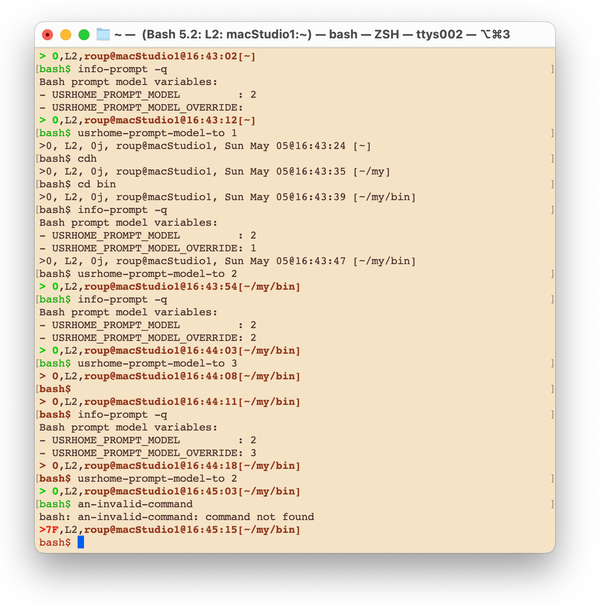

**The zsh prompts**

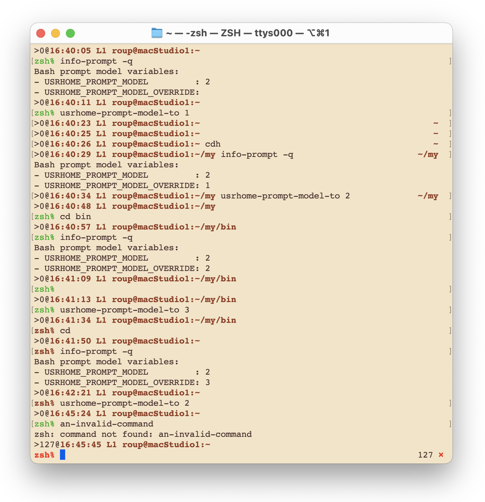

**Notable prompt features**

All provided prompts, show:

- A leading '>' character,
- the exit code of the last command, in decimal or hexadecimal,
- current time in 24-hour HH:MM:SS format,
- the shell nested level, prefixed with 'L',
- optional user-name @ host-name,
- the full or last 3 directory components of the current directory,
- the shell name (bash, or zsh),
- the last character is '#' if the current user has root privilege,
  otherwise the '$' character is used for bash and the '%' character is for zsh.

Some also show the Week day and month date, the number of currently running jobs
of the shell.

Prompt model 2 and 3 prints the elapsed time of the last command with
millisecond resolution.  On macOS without GNU coreutils gdate available the
resolution is in seconds.

The zsh prompt can also print extra information:

- zsh prompt model 1 shows extra information on the right side of the line,
  there is enough room: the full path of the current directory, and VCS (Git or
  Mercurial) repository name.
- The VCS (Git or Mercurial) repository name is shown in all zsh prompts.

  - If the current directory is part of a Git or Mercurial repository, the
    prompt shows 2 spaces followed by:

    - 'git:' for Git repository and 'hg:' for Mercurial repository,
    - the VCS branch name in parenthesis
    - the VCS repository name.

- Exit code of error and number of running jobs are  also shown in the right
  hand side in zsh prompts.

  - If the exit code of the last error is not 0, the exit code followed by
    a red '⨯' character.
  - If the shell has sub-process jobs, the number of jobs is shown,
    followed by a yellow '⚙' character.

**Examples**

Some extra examples shown here:

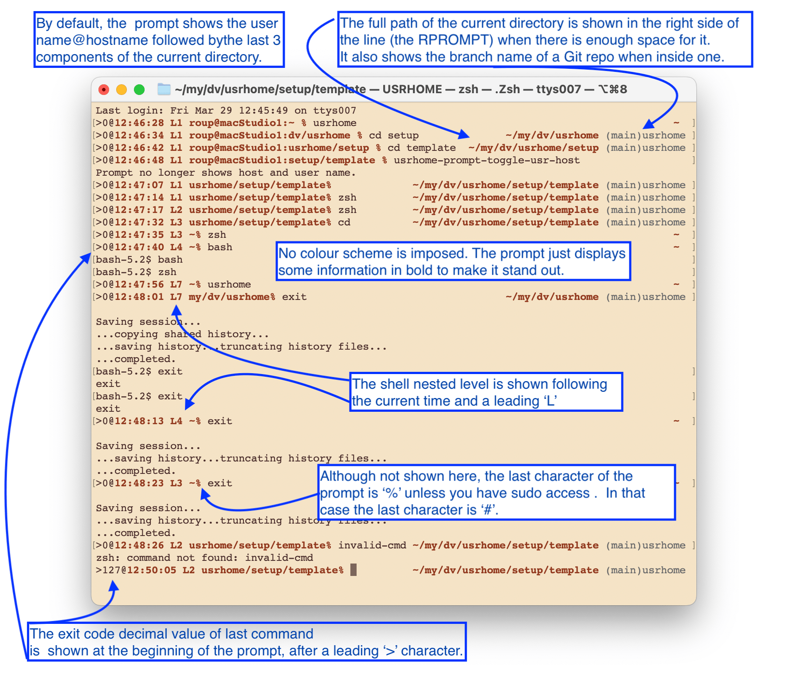


Here's an example when the prompt model 2 is selected by user configuration
and the user dynamically changes it inside the shell.


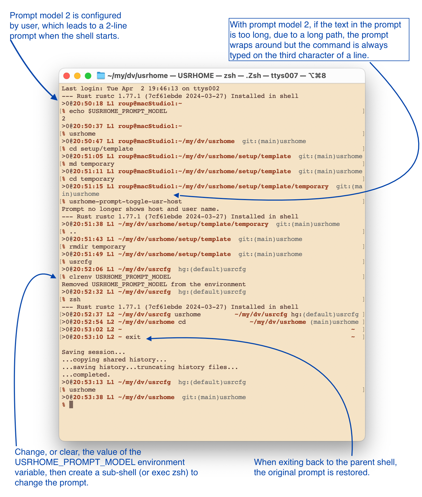

And here's another example, when the shell with prompt model 2, has two nested
instances of suspended Emacs running, in a macOS terminal.

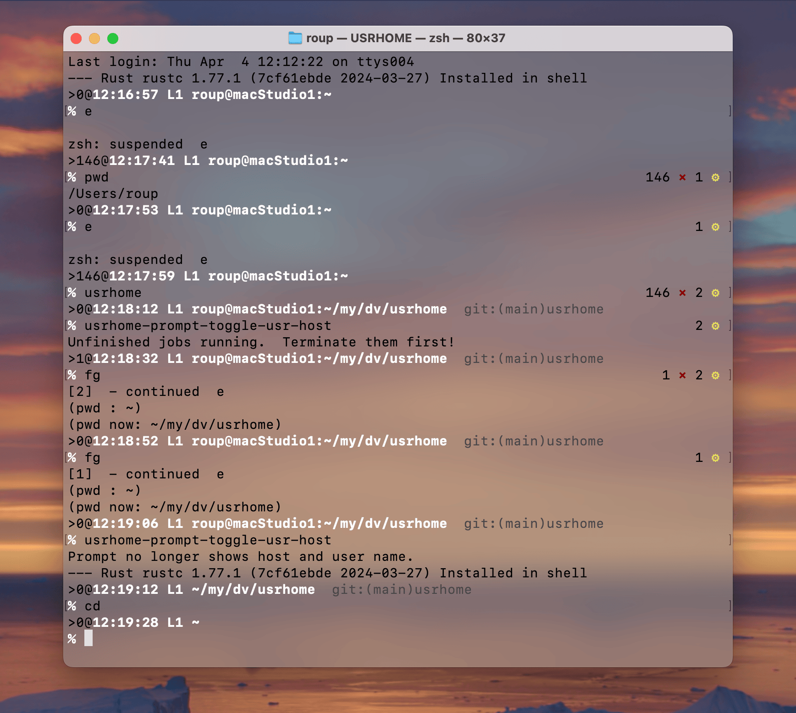

When the shell has running background jobs, the USRHOME commands that use
``exec zsh`` to re-initialize the Z Shell won't proceed and will print a
warning message instead.  In the example above the two running process where ``e`` the
USRHOME name for terminal-based emacs.  To be able to change the process
prompt, these two suspended Emacs process must first be terminated (by making
them active in the foreground again with ``fg`` and then closing Emacs).  Once
there's no background process the ``usrhome-prompt-toggle-usr-host`` command
can be used.

Showing the shell type helps when capturing commands for logs: it explicitly
identifies the shell.

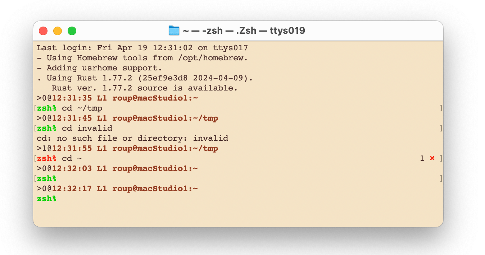

Prompt Search Regexp
--------------------

Use the following regular expressions to search a prompt, or
to install them in editors, like Emacs, to navigate through
prompt lines inside a shell.

The regular expression syntax shown here correspond to the
`Emacs 'string-format' regular expression syntax`_, the syntax you can use
inside Emacs configuration.

============================ ========================================
Prompt                       Emacs Regular Expression
============================ ========================================
All models                   ``^\(\(zsh\)\|\(bash\)\)[%#$]``
============================ ========================================


USRHOME Commands and Scripts
============================

USRHOME print policy
--------------------

he USRHOME print functions provide output for users in interactive
sessions. They suppress output during unattended execution and in Emacs Tramp
sessions.


**When the functions print:**

The print functions can produce output:

- During interactive shell startup that the user sees.
- In scripts sourced or executed directly or indirectly from an interactive session.

For example, both commands can print when run from a permitted interactive session:

.. code:: sh

          usrhome-test-print
          sh -c 'usrhome-test-print'

In both cases, the ``TERM`` and output-stream rules below also apply. The script’s
shebang and the interactivity of an intermediate shell do not, by themselves,
determine whether printing is permitted.

The print functions suppress output during unattended shell startup and
scheduled jobs when ``USRHOME_PRINT_ENABLED`` is unset or is not ``1``.
A non-interactive shell started by an interactive session can inherit
``USRHOME_PRINT_ENABLED=1`` and permit printing. The scheduled-job boundary
below explains how to prevent a scheduled job from inheriting that permission.

If ``TERM`` is unset, empty, or dumb, all print functions suppress output. This
rule also applies when ``USRHOME_STDERR_PRINT_TO_PIPE=1``.

**Output streams**

USRHOME scripts send warning and error information, including related details,
to standard error (stderr). They send requested results and help to standard
output (stdout).

When printing is permitted, usrhome_printf can write to stdout even when
stdout is redirected to a pipe or file.

The stderr functions are:

- usrhome_printf_stderr
- usrhome_printf_warning
- usrhome_printf_error
- usrhome_print_warning
- usrhome_print_error

By default, these functions print only when stderr is connected to a
terminal. A normal stdout pipe does not redirect stderr:

.. code:: sh

   command | consumer

If the caller redirects stderr, setting ``USRHOME_STDERR_PRINT_TO_PIPE=1`` permits
the stderr functions to write to that destination:

.. code:: sh

          USRHOME_STDERR_PRINT_TO_PIPE=1 usrhome-test 2>errors.log
          USRHOME_STDERR_PRINT_TO_PIPE=1 usrhome-test 2>&1 | consumer

The override applies to non-terminal stderr destinations, including files as
well as pipes. It does not override the TERM or unattended-execution rules.

When redirected the USRHOME printing functions never print color escape
sequences, it makes processing of the printed easier.

USRHOME scripts must not explicitly redirect individual calls to the stderr
print functions. A caller may redirect a script’s stderr. A future lint-sh
check could report explicit violations within USRHOME scripts.

**Scheduled-job boundary**

USRHOME uses ``USRHOME_PRINT_ENABLED`` as the session print-policy variable.
The startup files that initialize it set and export it to ``1`` when the shell
is interactive and at least one of stdin, stdout, or stderr is a terminal.
Otherwise, those files leave any inherited value unchanged.

Child processes can inherit ``USRHOME_PRINT_ENABLED=1``. This allows scripts
started directly or indirectly from the interactive session to print, subject
to the TERM and output-stream rules. The variable does not determine whether
a user is watching.

A scheduled-job launcher must unset ``USRHOME_PRINT_ENABLED`` or set it to
``0`` before starting the job. For example:

.. code:: sh

   unset USRHOME_PRINT_ENABLED
   exec /path/to/scheduled-script

A later interactive startup with a terminal can set the variable to ``1``
again.

**Scope**

This policy applies to the USRHOME print functions. It does not suppress
direct printf calls or output from other commands.

**Printing Strategy**

USRHOME separates requested results and help from diagnostics and progress.
USRHOME prints requested results on stdout.  It uses stderr for diagnostics
and progress where they must not contaminate results.  The code respect
explicit user redirection; it does not suppress all output merely because a
stream is not a terminal.

This is separate from the ``TERM=dumb`` and unattended-session policy. In
particular, changing a result to direct printf would bypass the current
helper’s suppression policy so using the USRHOME print and printf functions is
recommended.


.. ---------------------------------------------------------------------------


Shell Behavior Control
----------------------

================================== ================================================================
USRHOME Command Name               Description
================================== ================================================================
`usrhome-shell-toggle-tracing`_    Toggle tracing the execution of the shell configuration files
                                   when a shell starts.  This toggles the value of the
                                   ``USRHOME_TRACE_SHELL_CONFIG`` environment variable from 0 to 1
                                   and vice-versa.

                                   Note that if the variable value was a file name, toggling it
                                   twice will simply re-activate the tracing to stdout, not to the
                                   file.

                                   - The original value of this environment variable is set inside
                                     your `usrcfg/setfor-all-config.sh`_ file.
                                     The default value is 0 as
                                     identified by `usrhome/template/setfor-all-config.sh`_
                                     used to initialize the usrcfg file.

                                   In Zsh, this command may need to restart the
                                   shell to update the prompt. See restart
                                   confirmation below.

`usrhome-prompt-toggle-usr-host`_  Toggle the inclusion of the user name and host name inside
                                   the prompt.

                                   In Zsh, this command may need to restart the
                                   shell to update the prompt. See restart
                                   confirmation below.

                                   The command is not affected by this limitation when issued
                                   in the Bash shell.

`usrhome-prompt-model-to`_ NUMBER  Dynamically change the prompt model to the specified NUMBER.

                                   - This command also supports the ``-h`` and ``--help`` command
                                     line options which pint the usage.

                                   In Zsh, this command may need to restart the
                                   shell to update the prompt. See restart
                                   confirmation below.

                                   The command is not affected by this limitation when issued
                                   in the Bash shell.
================================== ================================================================

The above commands may need to restart the shell under some conditions.
Before a command restarts the shell, it warns that unsaved shell history
and other shell state may be lost, and asks for confirmation. The
confirmation does not save shell history. The result depends on the shell
history configuration.

Enter ``y`` or ``Y`` to restart. Any other response, including an empty
response or end of input, cancels the restart and leaves the setting
unchanged. If the command cannot prompt in an interactive terminal, it
cancels the restart.

The commands do not restart the shell while unfinished jobs are present.
Terminate the jobs before retrying.

Custom Zsh prompt
~~~~~~~~~~~~~~~~~

Zsh prompt model 0 supports a custom prompt defined in
``$USRHOME_DIR_USRCFG/do-user-zshrc.zsh``. If the prompt setup must run
at shell startup, set the restart model to 0 in that file::

    export USRHOME_PROMPT_MODEL_REQUIRES_RESTART=0

Keep this assignment outside any model-specific condition. Run the custom
prompt setup only when the selected model is 0. The selected model is
``USRHOME_PROMPT_MODEL_OVERRIDE`` when that variable is nonempty;
otherwise, it is ``USRHOME_PROMPT_MODEL``.

When you select model 0, USRHOME asks for confirmation before replacing
the current Zsh shell. The new shell runs the startup configuration
again. If you cancel, the prompt setting remains unchanged.

The restart variable identifies a model number. The value 0 does not
disable restarts. If the variable is unset or has another value, USRHOME
selects its simple Zsh prompt for model 0.


Shell Status Info
-----------------

USRHOME provides the following special commands that provide useful information about the current
shell and can also serve as help reminders when writing shells script code.

These are implemented as shell functions or alias inside `usrhome/ibin/setfor-alias`_.

================================== ================================================================
USRHOME Command Name               Description
================================== ================================================================
``info-desktop``                   Print the name of the desktop software type being used.
                                   Internally also set the shell variable USRHOME_DESKTOP which can
                                   later be used inside shell scripts.

                                   - Implemented in: `usrhome/ibin/setfor-alias`_ as a shell
                                     function.

``info-prompt [-q]``               Print information about shell's prompt controlling variables.
                                   By default it prints the values of all variables.  With the
                                   ``-q`` option it only prints the values of
                                   the ``USRHOME_PROMPT_MODEL``
                                   and ``USRHOME_PROMPT_MODEL_OVERRIDE`` values.  The first one
                                   shows the value of the default prompt mode, the second one, if
                                   set, is the model of the current prompt,
                                   overriding the default.

                                   - Implemented in: `usrhome/ibin/setfor-alias`_ as a shell
                                     function.

``info-rosetta2``                  Available on macOS only.  Checks whether `Rosetta 2`_ is installed
                                   and prints info about it.

                                   - Implemented in: `usrhome/ibin/setfor-alias`_ as a shell
                                     function.


``info-shell-special-var [ARGS]``  List the shell special variables like ``$*``, ``$@``, ``$?`` and
                                   others,  describing their purpose and showing their values.

                                   - When command line arguments are passed to the command, it
                                     prints the positional arguments, the value of ``"$*"`` and
                                     ``"$@"``  helping you remember the basic differences.  Try it
                                     by passing a glob_ to it like ``*``.
                                   - Implemented in: `usrhome/ibin/setfor-alias`_ as a shell
                                     function.


``info-shell``                     Show current and default shell environment variable names
                                   and values.

                                   - Implemented in: `usrhome/ibin/setfor-alias`_ as a simple
                                     alias.
================================== ================================================================

Terminal Window Control
-----------------------

================================== ================================================================
USRHOME Command Name               Description
================================== ================================================================
``set-title [TITLE]``              Set the terminal's title to the value passed as its first
                                   parameter.  The terminal title is shown on the window title bar.
                                   The command accepts only 1 parameter, so if you want to set the
                                   title with embedded spaces just quote the entire title.
                                   With no argument: removes the title.
``restore-title``                  Restore title that might have been affected by error.
================================== ================================================================


Listing Files/Directories/Links
-------------------------------

The following command shortcuts for specialized use of **ls** are provided by USRHOME.

================================== ================================================================
USRHOME Command Name               Description
================================== ================================================================
``l``                              Colorized **ls** that also shows the file type symbol.

                                   - Supports supplementation ls options and arguments.

``la``                             Same as ``l`` but also show hidden files.

                                   - Supports supplementation ls options and arguments.

``ll``                             ``ls -l`` with colorized and  file type symbols.

                                   - Supports supplementation ls options and arguments.

``lla``                            Same as ``ll`` but also show hidden files.

                                   - Supports supplementation ls options and arguments.

``lt``                             ``ls -ltr`` with colorized and  file type symbols.

                                   - Supports supplementation ls options and arguments.

``lta``                            Same as ``lt`` but also show hidden files.

                                   - Supports any ls options.

``lsd [NAME]``                     List sub-directories in current directory.

                                   - NAME: optional name or first letters of the names.

                                   - If the ``USRHOME_USE_PIKE`` environment variable
                                     is set to 1 inside your ``$USRCFG/setfor-all-config``
                                     file, lsd is an alias to the ``lsdd`` tool utility
                                     described below and provides many more features.

``lsda [NAME]``                    List sub-directories in current directory,
                                   includes hidden directories.

                                   - NAME: optional name or first letters of the names.
                                   - If the ``USRHOME_USE_PIKE`` environment variable
                                     is set to 1 inside your ``$USRCFG/setfor-all-config``
                                     file, lsda is an alias to the ``lsdd -a`` tool utility
                                     described below and provides many more features.


``lsdd [OPTION] [FILE...]``        List directories only.

                                   - FILE is either a file name or glob.
                                   - Either can use an absolute or relative path,
                                     where ~ identifies the users' home directory.
                                   - Multiple FILE /globs can be specified.
                                   - Only directories or symlink to directories
                                     identified  from the FILE(s) are listed.
                                   - If no FILE is specified ``lsdd`` lists all
                                     the directories in the current working directory.
                                   - Hidden directories are not listed unless
                                     the ``-a`` option is specified.
                                   - The short OPTIONS can be concatenated
                                     (as in ``-lart``) or passed separately
                                     (as in ``-l -a -r -t``).

                                   `lsdd`_ is implemented as a `Pike`_ script;
                                   to use it you must have `Pike`_ installed.
                                   Pike scripts are compiled then executed but the
                                   compilation is fast.  To use it simply type the
                                   command on the shell.
                                   It is a much better implementation than the shell
                                   scripts lsd and lsda.

``lsl [-l] ['NAME']``              List symbolic links in current directory.

                                   - With ``-l``, list using the ``ls -l`` format.
                                   - ``NAME``: optional symlink name glob pattern. Must be placed
                                     withing single quotes.
                                   - Also support the ``-h`` and ``--help`` options to show its
                                     usage.
================================== ================================================================

Command to Display and Manipulate Environment Variables
-------------------------------------------------------

The following commands help manage and read the content of environment
variables used int he current shell.  Any modification to an environment
variable become available to the current shell and any sub-shells.  It does
not persists once the shell exits.

================================== ================================================================
USRHOME Command Name               Description
================================== ================================================================
``add-to-path DIRPATH``            Add DIRPATH to the front of the current shell PATH.

``add-to-path --end DIRPATH``      Add DIRPATH to the end of the current shell PATH.

                                   - This is an alias to ``_usrhome_add_to_path`` implemented in
                                     the file `usrhome/ibin/setfor-alias`_

``clrenv VARNAME``                 Clear (remove) the environment variable specified by name from
                                   the environment of the *current* shell.

                                   - This is an alias to ``_usrhome_clrenv`` implemented in
                                     the file `usrhome/ibin/setfor-alias`_

``setenv VARNAME VALUE``           Set the environment variable named VARNAME to the specified
                                   VALUE and inject it inside the *current* shell.

                                   - This is an alias to ``_usrhome_setenv`` implemented in
                                     the file `usrhome/ibin/setfor-alias`_

``use-usrhome``                    Add USRHOME binary directory and ``~/bin`` to PATH if present.
                                   This command is automatically executed for zsh shell started
                                   under USRHOME control.

                                   - This is an alias to `usrhome/ibin/envfor-usrhome`_

``use-homebrew``                   Add Homebrew directories to PATH if required for the CPU
                                   architecture.
                                   This command is automatically executed for zsh shell started
                                   under USRHOME control when the ``USRHOME_USE_HOMEBREW``
                                   environment variable is set to 1 inside the USRHOME user's
                                   common shell configuration file
                                   ``usrcfg/setfor-all-config.sh`` .

                                   - This is an alias to `usrhome/ibin/envfor-homebrew`_


``use-info``                       Add ``info`` directories located in standard places to
                                   the ``INFOPATH`` environment variable.  Use it to extend
                                   the ``INFOPATH`` when using the `stand-alone GNU info reader`_
                                   or info within Emacs.  It searches for info directories once
                                   per process tree inside the following potential locations:

                                   - Homebrew
                                   - Emacs source repository, which must be identified by the
                                     USRHOME_DIR_EMACS_SRC environment variable.

                                   Currently this list of locations is hard coded inside the
                                   `usrhome/ibin/envfor-info`_ file.

                                   - This is an alias to `usrhome/ibin/envfor-info`_

``append_to_path DIRS``            Append directories to PATH.

                                   - DIRS is either one directory or a list a
                                     colon-separated directories.
                                   - Appends only the directories that exits
                                     and are not already present in PATH.
                                   - Examples:

                                     - ``append_to_path ~/my-bin``
                                     - ``append_to_path ~/my-bin:$HOME/other-bin``
                                     - ``append_to_path $HOME/my-bin:$HOME/other-bin``

                                   - **Caution**: shells only expand the ~ at the beginning
                                     of strings, therefore you cannot use it elsewhere in the
                                     list!

``prepend_to_path DIRS``           Prepend directories to PATH.

                                   - DIRS is either one directory or a list a
                                     colon-separated directories.
                                   - Prepends only the directories that exits
                                     and are not already present in PATH.

                                     - Examples:

                                       - ``prepend_to_path ~/my-bin``
                                       - ``prepend_to_path ~/my-bin:$HOME/other-bin``
                                       - ``prepend_to_path $HOME/my-bin:$HOME/other-bin``

                                   - **Caution**: shells only expand the ~ at the beginning
                                     of strings, therefore you cannot use it elsewhere in the
                                     list!

``showpath [-n] [varname][PATH]``  Print the value of PATH, MANPATH or LIBPATH, or any PATH
                                   specific environment variable placing each directory
                                   in its own line.

                                   The command accepts shortcut names for MANPATH and LIBPATH
                                   as MAN and LIB respectively.

                                   The command also accepts the name of any other environment
                                   variable that exists in the environment.

                                   With the optional ``-n``: print a left justified number on
                                   each line.
                                   Examples:

                                   - ``showpath`` : prints PATH, one directory per line,
                                   - ``showpath PATH``: prints PATH, one directory per line,
                                   - ``showpath -n``: prints PATH with numbered lines,
                                   - ``showpath -n PATH``: prints PATH with numbered lines,
                                   - ``showpath -n MANPATH``: prints MANPATH with numbered lines,
                                   - ``showpath MAN``: prints MANPATH without numbers.

                                   If the format of the path variable is incorrect, the command
                                   prints an error message on stderr. Empty entries are errors,
                                   except for one MANPATH marker: a leading colon, a trailing
                                   colon, or one internal double colon. Multiple markers and
                                   whitespace-only entries are errors.

                                   The exit codes are:

                                   - 0 on success (or help),
                                   - 1 on invalid argument(s),
                                   - 2 when specified environment variable is not defined,
                                   - 3 when the format of the specified path is incorrect.

                                   Note: when MANPATH is undefined, ``showpath`` uses the manpath_
                                   command (if available) and prints the path it returns.  It also
                                   prints a warning on stderr and exit with an
                                   exit-code of 0.

                                   Help is printed when the ``-h`` or ``--help`` option is used.

``usrhome-env``                    Display the values of all USRHOME environment variables
                                   currently set in the shell.

``usrhome-switch-path``            Modify PATH.  Swap current PATH with the value stored inside the
                                   ``USRHOME_ORIGINAL_PATH`` environment variable.  This is set to
                                   PATH value the system had inside the shell before USRHOME
                                   added support for itself and other tools.

``sanitize-path [VARIABLE]``       Sanitize a PATH-like variable in the current shell.
                                   The alias calls ``_usrhome_sanitize_path``.  The default
                                   variable is PATH.  The named variable must be set and
                                   writable.  The command removes leading whitespace from
                                   entries, removes duplicates while keeping the first
                                   occurrence, and removes empty entries.  On success, it
                                   exports the sanitized variable.

                                   The function returns:

                                   - 0 on success;
                                   - 1 for an invalid request or processing error;
                                   - 2 if cleanup produces an empty value. In this case,
                                     the original value is unchanged.

                                   The sanitizer does not check that directories exist or are
                                   safe.  If sanitization fails, do not assume the original
                                   value is safe.

                                   More values are valid for MANPATH and the sanitizer accepts
                                   MANPATH values that consist of only one colon or have a single
                                   colon at the beginning or the end of the string or has a single
                                   instance of a double colon between two directories.
                                   These special cases identify where the systems default search
                                   path for man are inserted.

                                   The sanitizer does not accept the single colon or extra leading
                                   or trailing colon or any double colons or more inside the value
                                   of any other environment variable and removes them.

                                   In an interactive shell, the command warns when it changes
                                   the value, unless TERM is ``dumb``.

                                   The command is silent if the value is valid and has not been modified.
================================== ================================================================

Dynamic Path Management
~~~~~~~~~~~~~~~~~~~~~~~

The USRHOME commands and environment variables allow the dynamic management of the PATH
in the *current*  shell.  Here's a screen shot of this being done on a macOS Computer running on
Apple Silicon CPU architecture.

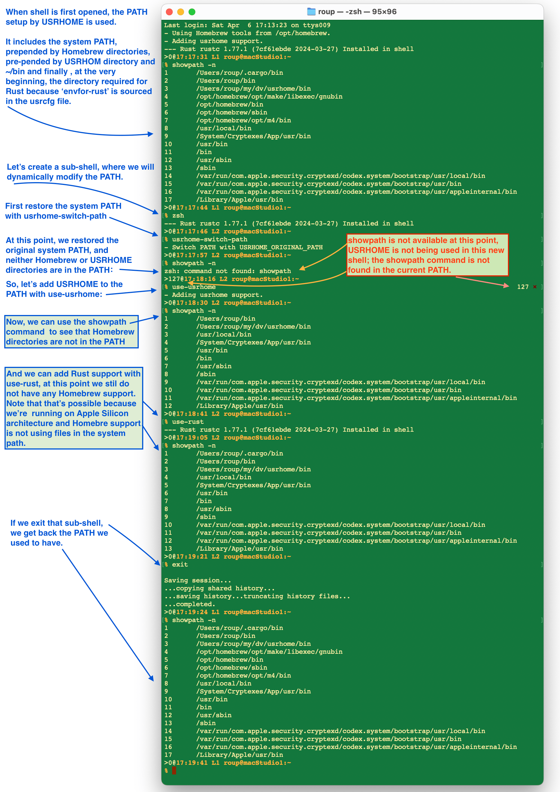

Help for Zsh Builtin Commands
-----------------------------

USRHOME provides a ``help`` function in interactive Zsh shells. Use it
to request help for a builtin command. For example::

  help cd
  help kill

On the first call, ``help`` initializes Zsh's ``run-help`` function.
It preserves an existing ``run-help`` function or autoload declaration.
If neither exists, it attempts to load ``run-help`` from ``fpath``.
Later calls use ``run-help`` without repeating directory discovery.

USRHOME selects a Zsh help directory in this order:

1. A non-empty ``USRHOME_DIR_HELPDIR`` value.
2. A non-empty ``HELPDIR`` value.
3. A directory found in common Zsh installation locations.

For discovery, USRHOME checks versioned and unversioned ``help``
directories under ``/usr/share/zsh``, ``/usr/local/share/zsh``, and
``/opt/homebrew/share/zsh``. If necessary, it searches within those
installation directories using ``fd`` or, if ``fd`` is unavailable,
``find``.

The selected directory must contain a readable ``cd`` or ``print`` help
file. If an explicitly configured directory fails this check, ``help``
reports an error instead of searching for another directory. If discovery
finds no directory, ``help`` reports a warning and lets ``run-help`` use
its default and other help sources.

If ``run-help`` cannot be loaded, ``help`` uses the system ``man``
command. With a topic, it passes the topic to ``man``. Without a topic,
it requests ``man zshbuiltins``.

To select a help directory, set ``USRHOME_DIR_HELPDIR`` before the first
``help`` call. For a persistent setting, add a line like this to
``usrcfg/setfor-all-config.sh``, using the path for your system::

  export USRHOME_DIR_HELPDIR="/path/to/zsh/help"

After successful initialization, open a new interactive Zsh shell to
repeat discovery with changed settings. If an explicit directory is
invalid, correct the value and retry ``help`` in the current shell.

USRHOME skips this configuration when ``TERM`` is ``dumb`` and
``INSIDE_EMACS`` is unset.

**Example on Kali Linux:**

Here we can see the use of USRHOME in a Kali Linux system where zsh is the
default shell.  At first it was setup with the older USRHOME version that did
not support help.    Then USRHOME is updated with a ``git pull`` command and
then we can open a new shell where ``help kill`` works as expected.

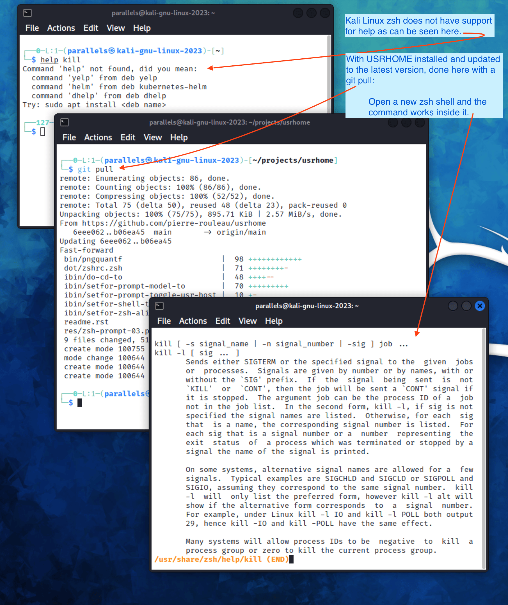

**Example on macOS Sonoma**

With USRHOME support the ``help kill`` command works on macOS zsh.

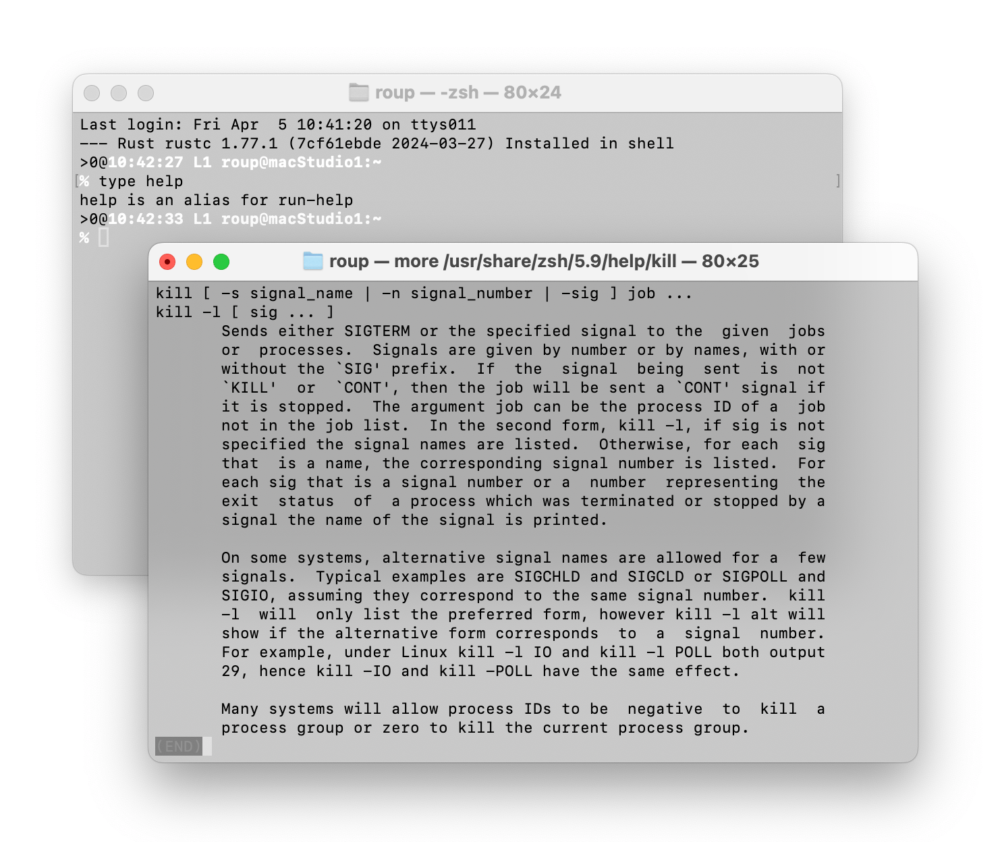

CBR -- Single commands to Check, Build or Run
---------------------------------------------

USRHOME supports 3 single letter commands for checking, building and running
code: ``c``, ``b`` and ``r`` respectively.  These are command aliases that are
installed inside the shell by the ``use-cbr`` command (which is an alias
itself to `usrhome/ibin/envfor-cbr`_).

The ``c``, ``b`` and ``r`` commands are aliases to the ``_usrhome_c``,
``_usrhome_b`` and ``_usrhome_r`` functions. These functions are defined by
`usrhome/ibin/envfor-cbr`_. They inspect the current directory to select
the mechanism for the requested action.

This currently supports the following construction methods:

- Running a local ``cbr`` executable file if one exists.  More on this below the table.
- Building single-file C and C++ programs with GNU make, taking advantage of
  GNU Make built-in rule for building the single C and C++ programs.
- Building programs with the 'make' command when the directory holds a
  'Makefile' or 'makefile'.
- Build Rust program with Cargo.
- Build Rust single main.rs program.

Once installed inside the shell with ``use-cbr``, the following commands are
made available:

=======  =============================================================
Command  Description
=======  =============================================================
``c``    **Check**.  Perform command(s) required to check the validity
         of the source code in the current directory.

``b``    **Build**. Perform command(s) required to build an executable
         from the source code in the current directory.

``r``    **Run**. Perform command(s) required to build an executable
         from the source code in the current directory and run it.
=======  =============================================================

Once you have typed ``use-cbr``, simply ``cd`` into the code directory and
type one of the 3 letters.  For example, type ``r`` to compile, link and run a
Rust program from the top directory of the Rust program.

If the commands cannot identify how to build the program it reports an error,
returning with exit code of 1.


**Using a local cbr executable file:**

After executing ``use-cbr``, the  ``c``, ``b`` and ``r`` commands
check if a local ``cbr`` or ``.cbr`` executable file is located in the current directory.
If they find one they pass control to it, as described below. If there's none,
then the command try to detect how to build the files in the directory with
the construction methods described above.

When the ``cbr`` executable file is found the commands invoke it passing all
arguments to it.  The ``cbr`` command should expect and support, as their
first argument, the letters c, b and r, and should act accordingly.

This can do anything your project requires, like invoking a special build
tool with the necessary arguments.  It can be useful when CBR currently does
not support the construction method you need.

A local ``cbr`` or ``.cbr`` executable can forward a command to the
project root. For example, create the following executable file in a
direct subdirectory of the project root:

.. code:: sh

          #!/bin/sh

          cd .. || exit 1

          . "$USRHOME_DIR/ibin/xtra/print-utilities.sh"
          . "$USRHOME_DIR/ibin/envfor-cbr"

          case "${1-}" in
              c) shift; _usrhome_c "$@" ;;
              b) shift; _usrhome_b "$@" ;;
              r) shift; _usrhome_r "$@" ;;
              *)
                  printf '%s\n' 'Usage: cbr c|b|r [arguments...]' >&2
                  exit 1
                  ;;
          esac

Set and export ``USRHOME_DIR`` to the absolute path of the USRHOME
installation before using this executable. The script changes to the
parent directory and passes the remaining arguments to the selected
CBR function. A local controller in that directory receives those
arguments. The built-in controllers currently ignore them.

USRHOME continue to support the now deprecated ``ibin/do-cbr``
command.  It still allows using something like this instead:

.. code:: sh

          #!/bin/sh
          cd .. || exit 1
          . "$USRHOME_DIR/ibin/do-cbr"


Using Emacs as a man reader
---------------------------

Anyone that have used Emacs knows that `Emacs man support`_ is really good.
For instance, with Emacs, you can follow all links that appear in man
pages; you essentially have access to a man page *browser* with access
of all Emacs features.

You can use `man (or woman)`_ right inside Emacs.  But at the shell, the
``man`` command will use the default man pager. Being able to open the man
pages with Emacs when typing the ``man`` command in the shell is what this
section is about.

USRHOME provides the ``use-emacs-for-man`` alias command that sets up the
current shell, replacing the ``man`` command by a ``man`` function that opens
the requested topic inside Emacs.  Both the ``use-emacs-for-man`` alias
command and the ``man`` function also accept an option switch that identifies
the way Emacs is launched.

To use this, you first execute ``use-emacs-for-man`` to setup the shell.
Then, when you type the man command inside that shell, the optic is shown
inside Emacs.

= ===================================== =============================================================
. Command                               Description
= ===================================== =============================================================
. ``use-emacs-for-man [-[gGsStT]]``     Install the Emacs-minded ``man`` command inside the shell.

                                        By default it sets the Emacs launching mode to the terminal
                                        mode. You can change this by using one of the following
                                        options:

                                        - ``-g`` : launch Emacs in GUI mode. Use the ``ge`` script to
                                          do so.  It will use the template version of that script
                                          located inside `usrhome/template/bin/ge`_
                                          unless it finds it on the PATH.
                                        - ``-G`` : same as ``-g`` but launches Emacs quicker with
                                          less initialization  by using Emacs -Q option.
                                        - ``-s`` : uses emacsclient to the Emacs daemon.

                                          - This checks if the Emacs daemon is already running.  If
                                            it's not running it starts it, after printing a message
                                            stating what it is doing.
                                          - Before using the man command with the Emacs daemon, you
                                            should launch an emacsclient process on something, if
                                            that's not already done, otherwise the man command will
                                            print an error telling you to start it.

                                        - ``-S`` : same as ``-s`` but does not delete an Emacs window
                                          after executing the man command. This is normally better
                                          when executing the man command from within a shell of
                                          the emacsclient itself.
                                        - ``-t`` : launch Emacs in terminal mode in the current
                                          shell. This is the default if no option is specified.
                                        - ``-T`` : same as ``-t`` but launches Emacs quicker with
                                          less initialization  by using Emacs -Q option.


. - ``man [-[gGsStT]] TOPIC``           Open Emacs man mode viewer for the specified TOPIC.
  - ``man -man [OPTIONS] TOPIC``
                                        - If no option is identified it launches Emacs as selected
                                          by the execution of ``use-emacs-for-man`` options.
                                        - If man is executed with one of the 6 options, it uses the
                                          method selected by the option, overriding what was selected
                                          by ``use-emacs-for-man``.

                                        If you want to use the system's native man command from
                                        a shell where you already executed ``use-emacs-for-man``,
                                        then you can use the ``-man`` special option, followed by
                                        all options you want to pass to the native man command.
                                        That executes the native man command with all options
                                        passed to it.
= ===================================== =============================================================

The advantage of using the Emacs daemon and an emacsclient_ are:

- Speed.  Since Emacs is already running, the man command does not have to
  launch a new Emacs process that has to run through the initialization process;
  it just opens the man page and renders it (if that has not already been done).
  Opening the man page is instantaneous this way.
- Reduced system memory consumption. One Emacs frame is required and can be
  used by the man command issued from several shells.
- When the ``-S`` option is used, all man pages that have been previously
  opened are left open inside an emacsclient buffer.  They each retain the
  position where you left them when last looking at them.
- The Emacs daemon starts with your full initialization; all your configured
  Emacs features are available.

The advantage of *not* using the Emacs daemon and emacsclient is that you open a new Emacs process,
local to your shell with all its environment variables and you can continue using that instance of
Emacs independently from all others (if any).  It takes more tie to start but if your
initialization system is well done that's normally not excessive and it gives you access to
everything you normally use withing Emacs.

With USRHOME, you can take advantage of both methods, *happily eating your
cake and keep having it*!

It is possible to use both methods with multiple shells or inside the same shell by passing the
emacs mode option to the man command. You can use several shells and use different method inside
each one if you want.  Or just use one method.  The code is flexible.

**Getting help**
  You can pass the ``-h`` or ``--help`` options to both ``use-emacs-for-man``
  and the specialized ``man`` function.  They will print the usage and return
  an exit code of 1.
  The ``man`` command also prints a reminder that the native man command is not
  the one being used.

  .. figure:: res/use-emacs-for-man-00.png

**Exit Codes**

- On success; 0.
- On help request: 1
- On error: 2 or 3.
- For man ``-s`` and ``-S``, when topic is not found: 4.

**To Activate it Permanently in a Shell**:
  You may not always want to type the ``use-emacs-for-man`` command.
  Instead you can add a specific man behaviour permanently inside your shell by
  sourcing the `usrhome/ibin/envfor-emacs-for-man`_ inside your shell startup code.
  For example, you could add the following code inside your ``usrcfg/do-user-zshrc.zsh``
  file to activate a man that uses an emacsclient frame:

  .. code:: bash

            . "$USRHOME_DIR/ibin/envfor-emacs-for-man" -s

  The shells can be "*permanently*" customized this way by writing the logic
  that suits you inside your customization for the Z shell and the Bash shell
  into your usrcfg files.

  For example, on a macOS system I use, I activate Homebrew, Rust and the emacs server based man
  with customized logic that includes the following lines:

  .. code:: bash

            export USRHOME_SHOW_PATH_ACTIVATION=1
            export USRHOME_PROMPT_SHOW_USR_HOST=1
            export USRHOME_PROMPT_MODEL=2
            export USRHOME_USE_HOMEBREW=1
            . "$USRHOME_DIR_USRCFG/ibin/envfor-rust"
            . "$USRHOME_DIR/ibin/envfor-emacs-for-man" -s

  We can see this in the following screen-shot:

  .. figure:: res/use-emacs-for-man-01.png

*Side note*:
  My PEL_ project provides extensive information about Emacs (in form of extensive hyperlinked PDF
  files with a `PDF index`_ to a large set of topics and file format/language supports).
  The `help PDF`_ has a `section that describe Emacs man and woman support`_.

Additional Scripts
------------------

The tables below describe executable scripts, sourced scripts, and shell
commands. Command names link to their executable or sourced script. Other
shell aliases and functions link to the file that defines them.
Scripts in ``bin`` are available when the USRHOME command directory is
on ``PATH``. Platform-specific directories and internal helpers are
identified separately.


Tool Activation Commands
~~~~~~~~~~~~~~~~~~~~~~~~

Execute these commands inside a shell to activate the related commands
in the current shell.

====================================================== ===========================================================================
Command or file                                        Description
====================================================== ===========================================================================
`use-cc-options`_                                      Configure extra options for the augmented ``cc`` command.

`use-perlbrew`_                                        Activate an installed Perlbrew environment.

`use-sdkman`_                                          Activate an installed SDKMAN environment.

`use-lisp-with-clasp`_                                 Select the Clasp implementation used by ``lisp``.

`use-lisp-with-clisp`_                                 Select the Clisp implementation used by ``lisp``.

`use-lisp-with-roswell`_                               Select the Roswell implementation used by ``lisp``.

`use-lisp-with-sbcl`_                                  Select the SBCL implementation used by ``lisp``.

`use-gcc15-on-macos`_                                  Activate a GCC 15 toolchain on macOS.

`use-gnu-binutils-on-macos`_                           Activate Homebrew GNU binutils on macOS.

`use-gnubin-on-macos`_                                 Activate Homebrew GNU tools on macOS.

`use-llvm`_                                            Activate Homebrew LLVM on macOS.
====================================================== ===========================================================================

Programming Language Support
~~~~~~~~~~~~~~~~~~~~~~~~~~~~

====================================================== ===========================================================================
Command or file                                        Description
====================================================== ===========================================================================
`clang-version`_                                       Print the Clang version. If its C++ executable is missing, attempt to build
                                                       it with ``make``.

`isvalid-python3`_                                     Check a file with Python 3's ``compileall`` module.

`lisp`_                                                Launch the Common Lisp implementation selected by a ``use-lisp-with-*``
                                                       environment script.
====================================================== ===========================================================================

Code Analysis Commands
~~~~~~~~~~~~~~~~~~~~~~

====================================================== ===========================================================================
Command or file                                        Description
====================================================== ===========================================================================
`lint-sh`_                                             Analyze one shell script file or all shell script files in a directory
                                                       tree, performing validation checks that ShellCheck does not do. With ``-s``
                                                       or ``-S``, also execute ShellCheck. All USRHOME executable and source shell
                                                       files are analyzed by this tool.
====================================================== ===========================================================================


File Diff Operations
~~~~~~~~~~~~~~~~~~~~

====================================================== ===========================================================================
Command or file                                        Description
====================================================== ===========================================================================
`use-diff`_                                            Select the program invoked by USRHOME's ``diff`` dispatcher in the current
                                                       shell.

                                                       **Usage**::

                                                          use-diff [PROGRAM-NICKNAME]

                                                          Supported PROGRAM-NICKNAME:

                                                          - diff            : The default.  Use /usr/bin/diff.
                                                          - diff-u          : Use /usr/bin/diff -u
                                                          - bcomp           : Use Beyond Compare launcher
                                                          - bcompare        : Use Beyond Compare main application.
                                                          - svndiff-diff    : Use diff, but expect arguments provided by svndiff.
                                                          - svndiff-bcomp   : Use bcomp, but expect arguments provided by svndiff.
                                                          - svndiff-bcompare: Use bcompare, but expect arguments provided by svndiff.

                                                       **alias:** `to ibin/envfor-diff`_

diff_                                                  USRHOME diff_ is a shell-based dispatcher program.

                                                       - By default it uses the standard ``/usr/bin/diff`` program
                                                       - You can change this behaviour in the current shell by
                                                         executing the ``use-diff`` command (an alias which sources
                                                         the `envfor-diff`_ script).  With it, you can select other
                                                         programs that will be invoked by the command.

`diffo`_                                               Compare object files by their disassembled code.

                                                       **Usage**::

                                                          diffo -h | --help

                                                          diffo [[-w | --with-source]  [-s | --string] [-l | --less]]  OBJ-OLD OBJ-NEW

                                                             - OBJ-OLD            : path of the old object file.
                                                             - OBJ-NEW            : path of the new object file.
                                                             - -w | --with-source : insert C/C++ source code in the generated assembler.
                                                             - -s | --string      : also compare strings extracted from files.
                                                             - -l | --less        : pipe differences to less


`dumpo`_                                               Print an object's disassembly.

                                                       **Usage**::

                                                             dumpo -h | --help

                                                             dumpo [[-w | --with-source]  [-l | --less]] OBJ

                                                                - OBJ                : path of the object file.
                                                                - -w | --with-source : insert C/C++ source code in the generated assembler.
                                                                - -l | --less        : pipe differences to less
====================================================== ===========================================================================


Track Evolution of Compiled File
~~~~~~~~~~~~~~~~~~~~~~~~~~~~~~~~

Use the ``mk-diffo`` utility to track the evolution of a source code file
over its modifications by comparing the assembler code generated from the
compiler for it as it evolves.

mk-diffo does not compile that file; it generates the assembler code from the
existing object file and keeps a copy of the source file, the object file
and the assembler file for each time you use ``mk-diffo`` inside a directory
tree.  The root of the directory tree is named after a project and under it
the source file name.  ``mk-diffo`` uses the ``diffo`` utility to generate the
assembler from the object file and the diff from the previous version.

After using it once, mk-diffo compares the generate assembler file of the
very first generated copy (by default) with the latest one it just
created. It then prints the difference if there are any.  If they are the
same, it prints a message stating that.

Before using ``mk-diffo``, execute ``use-mk-diffo`` to set up the environment
variables used to identify the location of the directory tree, the project
name, the name of the source code file, the directory where the object file
is stored and it's extension.

You'd typically execute ``mk-diffo`` after each compilation of the source code
file after it's modification to check if the generated code has changed.
This can be quite comforting to know that the generated assembler code has
not changed after making style-only code changes. Use it to reduce tension
among the development team when changing code to make it more readable, fix
warnings and any change you deem important but want to ensure no problem is
caused by those changes.


**To use it**:

- Make sure you compile the C/C++ source files with debugging activated.
- Specialize your shell by executing: ``use-mkdiffo``

  - This identifies the following:

    - ``USRHOME_DIFFO_ROOT_DIR``: The directory tree where all files are stored.
    - ``USRHOME_DIFFO_PROJECT`` : The project name; used as a sub-directory in the main directory tree.
    - ``USRHOME_DIFFO_FNAME``   : The full path to the source code file checked.
    - ``USRHOME_DIFFO_OBJ_DIR`` : The full path of the directory holding the the object file resulting from the compilation of the source code file.

- When executing mk-diffo, the extra information is passed:

  - The file version number, starting at 0 and incremented each time
    the mk-diffo command is issued for the specific project.

**Directory Tree**:

All files are stored inside a single directory tree. The directory tree has
four directory levels:

- The root directory identified by USRHOME_DIFFO_ROOT_DIR (here, ~/my/results/diffo).
- The project name, identified by USRHOME_DIFFO_PROJECT (in the following
  diagram you can see two projects: proj-1 and proj-2.)  Any name can be
  used.
- The file name, identified by USRHOME_DIFFO_FNAME.  Inside the proj-1, we
   can see file-a.c and file-b.c.  In project-2 we can see pel.cpp.
- The test number, starting at 0.

Here's an example of the directory tree maintained by ``mk-diffo``::

          ~/my/results
          └── diffo
              ├── proj-1
              │   ├── file-a.c
              │   │   ├── 000
              │   │   │   ├── file-a.asm
              │   │   │   ├── file-a.c
              │   │   │   └── file-a.o
              │   │   └── 001
              │   │       ├── file-a.asm
              │   │       ├── file-a.c
              │   │       └── file-a.o
              │   └── file-b.c
              │       ├── 000
              │       │   ├── file-b.asm
              │       │   ├── file-b.c
              │       │   └── file-b.o
              │       ├── 001
              │       │   ├── file-b.asm
              │       │   ├── file-b.c
              │       │   └── file-b.o
              │       └── 002
              │           ├── file-b.asm
              │           ├── file-b.c
              │           └── file-b.o
              └── proj-2
                  └── pel.cpp
                      └── 000
                          ├── pel.asm
                          ├── pel.cpp
                          └── pel.o

====================================================== ===========================================================================
Command or file                                        Description
====================================================== ===========================================================================
`use-mk-diffo`_                                        Setup the shell to use ``mk-diffo`` to track evolution
                                                       of the object code of a source code file.

                                                       **Usage**::

                                                          use-mk-diffo -h | --help

                                                          use-mk-diffo DB-ROOT-DIR PROJECT SRC_FNAME OBJ-DIR [OBJ-EXT]

                                                          where:
                                                            - DB-ROOT-DIR: The directory tree where all files are stored.
                                                            - PROJECT    : The name of the project to which SRC_FNAME belongs.
                                                                           That name is used as the name of the sub-directory
                                                                           of the main directory tree, identified by DB-ROOT_DIR
                                                            - SRC_FNAME  : The source code file name (with its extension).
                                                                           Identify the absolute path of the file or
                                                                           the path relative to the directory from where the
                                                                           mk-diffo commands will be issued.
                                                            - OBJ_DIR    : The full path of the directory holding the
                                                                           the object file resulting from the compilation
                                                                           of the source code file.
                                                            - OBJ-EXT    : Object file extension. Include the leading period.
                                                                           If not specified it defaults to ".o".
                                                                           To specify empty extension, if you want to track the
                                                                           evolution of single source file program executable,
                                                                           use " ".

                                                       **alias:** `to ibin/envfor-mk-diffo`_

`mk-diffo`_                                            Record and compare object code across versions. Requires the
                                                       ``USRHOME_DIFFO_*`` environment.

                                                       **Usage**::

                                                         mk-diffo [[-w | --with-source] [-s | --string] [-l | --less]] [REFNO]

                                                         Store the source and object file inside the mk-diffo directory tree
                                                         for the current file and reference number, then compare the object file
                                                         with the object file for the previous version or the version specified by
                                                         REFNO.

                                                            REFNO : optional reference number.  Default is last one created.
                                                                    It must be a valid integer.
                                                                    Leading 0 are accepted, but remain a base-10 value.

                                                            Options passed to diffo:
                                                            - -w | --with-source : insert C/C++ source code in the generated assembler.
                                                            - -s | --string      : compare strings extracted from files (always generated).
                                                            - -l | --less        : pipe differences to less

                                                         ENVIRONMENT:
                                                           - USRHOME_DIFFO_ROOT_DIR: The directory tree where all files are stored.
                                                           - USRHOME_DIFFO_PROJECT : The project name; used as a sub-directory
                                                                                     in the main directory tree.
                                                           - USRHOME_DIFFO_FNAME   : The source code file name.
                                                           - USRHOME_DIFFO_OBJ_DIR : Directory name of the corresponding object file.
                                                           - USRHOME_DIFFO_OBJEXT  : Object file extension. Include leading period.
                                                                                     Defaults to \".o\".
                                                                                     Use \" \" for extension-less files
                                                                                     if you want to analyze single source file
                                                                                     executable files.

====================================================== ===========================================================================


Git Support Commands
~~~~~~~~~~~~~~~~~~~~

====================================================== ===========================================================================
Command or file                                        Description
====================================================== ===========================================================================
`use-git-extra`_                                       Activation command: Set up extra Git completion for the shell where supported.

`git-lbr`_                                             List selected local or remote Git branches.

`git-log`_                                             Format Git history.

`git-status`_                                          Add HEAD information to Git status.

`git-sw`_                                              Check out a branch. Can use shell completion.

`git-cln`_ ``REPO`` ``BRANCH``                         Clone a Git repo and check out a specific branch.

                                                       - REPO:   the Git repository url.
                                                       - BRANCH: the Git branch name.  One that is shown by 'git branch'.

                                                       The git clone is only done if the specified BRANCH exists in the
                                                       specified REPO.  The local directory created for the REPO is named
                                                       after the BRANCH.

====================================================== ===========================================================================

Text File Format Conversion
~~~~~~~~~~~~~~~~~~~~~~~~~~~

====================================================== ===========================================================================
Command or file                                        Description
====================================================== ===========================================================================
`iconv-iso8859-utf8`_                                  Convert a file from ISO-8859-1 to UTF-8. Copy the original to
                                                       ``USRHOME_DIR_TMP`` and overwrite the input file.

`iconv-iso8859-utf8-all`_                              Use ``fd`` (or ``find``) and ``file`` to select files for the same
                                                       conversion. Review the selection and keep backups before use.
====================================================== ===========================================================================


Files and searches
~~~~~~~~~~~~~~~~~~

======================================== ===========================================================================
Command or file                          Description
======================================== ===========================================================================
`dsize`_ ``[DPATH]``                     Compute and print the size of files in a directory tree. DPATH defaults to
                                         the current directory. Without subdirectories, count bytes in each file.
                                         If the directory has no sub-directories the command counts
                                         the bytes of each files in the directory and produces a byte
                                         count. Otherwise it uses the ``du`` command, which runs faster,
                                         and print the size in units of 1024 bytes multiples.

`find-dir`_                              Find directories named DIR inside ROOT. ROOT defaults to the current
                                         directory. Hidden directories are excluded unless ``--inc-hidden`` or
                                         ``-H`` is specified.

                                         Usage::

                                           find-dir [--inc-hidden|-H] DIR [ROOT]
                                           find-dir [-h|--help]

                                           Find and print all directories with name 'DIR'
                                           inside the specified directory tree ('ROOT').

                                           - By default ROOT is the current directory.
                                           - By default exclude all hidden directories (such as .git)
                                             unless --inc-hidden option is specified.

                                           Exit codes: 0 if at least one directory found.
                                                     : 1 if nothing is found.
                                                     : 2 if the command line is invalid.

`flip-to-ln`_ ``DPATH FNAME``            Move file FNAME into directory DPATH and create a symbolic link at FNAME
                                         that points to the file.

                                         - Under Linux, where the GNU coreutils ln (>= 8.16) has the
                                           ``-r`` option switch, the symbolic links are always created
                                           relative if they can be.
                                         - Under macOS if you need to create relative symbolic links
                                           you must provide relative FNAME and DNAME arguments.

`files-in`_                              List entries in a directory tree, including symbolic links. ``-l`` requests
                                         a long listing.

`find-executable`_                       Search a directory tree for executable files. ``-H`` includes hidden
                                         directories and ``-L`` includes links to files.

`find-latest-in`_                        List recently modified files. Use ``-d`` for the directory, ``-t`` for the
                                         time window, and ``-f`` for a filename pattern. ``-H`` includes hidden
                                         entries and ``-I`` disables ignore rules. If ``fd`` is unavailable, the
                                         ``find`` fallback requires ``-I`` and uses extended regular expressions.
                                         Matching and timestamp precision can differ.

`find-perl`_                             Find Perl files and scripts. Can also search Perl's ``@INC`` directories.

`find-py`_                               Find Python files.

`find-since`_                            List files newer than a marker file.

`lslink`_                                List symbolic links under the current directory on Linux and macOS.

`lslink-broken`_                         List broken symbolic links.

`echo-grep`_                             Print a filename header and search that file with ``grep``. Accept a
                                         pattern and a filename.

`rg-all`_                                Run ``rg -L`` to follow symbolic links.

`rgabs`_                                 Search with absolute paths. Can use ``rga``.

`rgf`_                                   Search selected file types with ``rg`` or ``rga``. ``bin/sub/rg-f``
                                         implements its type dispatch.

`pngquantf`_ ``FNAME``                   Compress the PNG file identified by FNAME, with or without the ``.png``
                                         extension. Uses pngquant_.  Useful under Emacs `Dired`_ to comppress
                                         selected png files.

`print-if-exists`_                       Read paths from standard input and print the normalized paths that exist.

`withh-ls`_                              Print a header for the last argument before invoking ``ls``.

`withh-rpm`_                             Print a header for the last argument before invoking ``rpm``.

`download-website`_                      Use ``wget`` to download a URL tree into the current directory and adjust
                                         links for local viewing.
======================================== ===========================================================================

Directory Commands
~~~~~~~~~~~~~~~~~~

Directory Navigation
^^^^^^^^^^^^^^^^^^^^

Extensions to the ``cd`` command.

================================== ===========================================================================
Command or file                    Description
================================== ===========================================================================
`..`_ ``[DIR]``                    Change current directory to parent directory and optionally to its sibling
                                   specified by the optional argument.

                                   - ``..`` is equivalent to ``cd ..``
                                   - ``.. abc`` is equivalent to ``cd ../abc``

`...`_ ``[DIR]``                   Change current directory to grand-parent directory and optionally to its sibling
                                   specified by the optional argument.

                                   - ``...`` is equivalent to ``cd ../..``
                                   - ``... abc`` is equivalent to ``cd ../../abc``

`....`_ ``[DIR]``                  Change current directory to grand-grand-parent directory and optionally to
                                   its sibling  specified by the optional argument.

                                   - ``....`` is equivalent to ``cd ../../..``
                                   - ``.... abc`` is equivalent to ``cd ../../../abc``


`cd-to`_                           Search for file specified by file FNAME or directory DNAME in
                                   current directory tree.

                                   - Usage:

                                     - ``cd-to [-h|--help]``
                                     - ``cd-to [-H] FNAME``
                                     - ``cd-to -d [-H] DNAME``

                                   - The FNAME and DNAME can be expressed with `fd`_ glob support.
                                   - By default, does not search into hidden directories.
                                     Specify the ``-H`` option to search into them.
                                   - If **one** file/directory is found, change the current
                                     directory to the directory that holds it and print the
                                     ``ls -l`` for it.
                                   - If several files/directories are found, print a cautionary
                                     note with the number of found items and their path names
                                     (relative to current directory).

                                     - If the ``EDITOR`` environment variable is set, the script
                                       prompts the user for editing the items.  On a 'y' answer it
                                       edits the files found using the editor selected by ``EDITOR``.

                                   - File search performed by the `fd`_ utility.  If it's not
                                     installed the command exits with an error.

                                   - Exit code:

                                     - 0: one file was found, the current directory was changed.
                                     - 1: no file found.
                                     - n: the number of files found if they were not edited.

`pel`__ ``[SUBDIR]``               Change current directory to PEL_ depot directory or its sub-directory
                                   if specified by the SUBDIR argument.
                                   Also set terminal title to 'PEL'.

`usrhome`_ ``[SUBDIR]``            Change current directory to USRHOME depot directory or its sub-directory
                                   if specified by the SUBDIR argument.
                                   Also set terminal title to 'USRHOME'.

`usrcfg`_ ``[SUBDIR]``             Change current directory to the USRHOME personal/persistent
                                   configuration directory, usrcfg, or its sub-directory if specified
                                   by the SUBDIR argument.
                                   Also set terminal title to 'USRHOME:usrcfg'.
================================== ===========================================================================


__  ibin/setfor-alias#L587


Cd to Conceptual Directories
^^^^^^^^^^^^^^^^^^^^^^^^^^^^


================================== ================================================================
USRHOME Command Name               Description
================================== ================================================================
`cdh`_ ``[SUBDIR]``                cd to *home*: the directory identified by ``USRHOME_DIR_MY``
                                   or its identified ``SUBDIR``.

`cdlic`_ ``[SUBDIR]``              cd to the directory identified by the ``USRHOME_DIR_LIC``
                                   or its identified ``SUBDIR``.

`cdlog`_ ``[SUBDIR]``              cd to the directory identified by the ``USRHOME_DIR_LOG``
                                   or its identified ``SUBDIR``.

`cdv`_ ``[SUBDIR]``                **On macOS only**, cd to the ``/Volume`` directory
                                   or its identified ``SUBDIR``.

`cdtmp`_ ``[SUBDIR]``              cd to user-specific temporary directory, identified by
                                   ``USRHOME_DIR_TMP`` or its identified ``SUBDIR``.

`cdpub`_ ``[SUBDIR]``              cd to *public projects*; the directory identified by
                                   ``USRHOME_DIR_PUBLIC``, or its identified
                                   ``SUBDIR``.
                                   This directory tree is meant to hold the
                                   repositories of your public projects.

`cdother`_ ``[SUBDIR]``            cd to *other public projects*; the directory identified by
                                   ``USRHOME_DIR_OTHER``, or its identified
                                   ``SUBDIR``.
                                   This directory tree is meant to hold clones
                                   of public projects repositories where you
                                   do not submit anything.

`cdlocal`_ ``[SUBDIR]``            cd to *local, private, projects*; the directory identified by
                                   ``USRHOME_DIR_LOCAL``, or its identified
                                   ``SUBDIR``.
                                   This directory tree is meant to hold files
                                   that you keep on your system and do not
                                   publish anywhere.

`cdcontract`_ ``[SUBDIR]``         cd to *local, private, contract projects*; the directory identified by
                                   ``USRHOME_DIR_CONTRACT``, or its identified
                                   ``SUBDIR``.
                                   This directory tree is meant to hold
                                   contract related files
                                   that you keep on your system and only share
                                   with your customer or employer.

================================== ================================================================

The commands described above change the current directory to several conceptually important
(*holder*) directories.  Those directories are identified by USRHOME environment variables.
The name of these environment variables start with the ``USRHOME_DIR_``
prefix. They are:

USRHOME_DIR_MY:
  The directory where all your development directories are located.

  - On macOS, it is often different from ``HOME``:

    - it could be ``$HOME/Documents`` if you want the files located
      in that directory tree replicated by Apple iCloud or,
    - it could be another directory, like ``$HOME/my`` if you do *not*
      want them replicated and stored in the iCloud.

  - On any system, it could be used to identify a directory tree specific to a given activity or content
    type or just be set to the value of ``$HOME``.

USRHOME_DIR_LIC:
  The directory where you could collect all the licence files you have agreed with when
  using a software service or package.

USRHOME_DIR_LOG :
  The directory where you could store activity log files and notes.

USRHOME_DIR_TMP:
  The name of a directory where your user's temporary files may be stored,
  in a separate directory than the standard ``/tmp`` directory.
  That can be used for testing code and checking if your tested code suffers from
  *temporary file leakage*.


**Where to Define these Environment Variables**

These environment variables are defined in the user persistent configuration
file common to Bash and Z Shell: the ``usrcfg/setfor-all-config.sh`` file.

During installation_, the `setup/setup-usrhome`_ script initializes them
to the value stored in `usrhome/template/setfor-all-config.sh`_ template file.
You can change them or add logic in your file to control their values any way you need.

The following commands are shortcuts to change the current directory to one of these
directories.

**Obsolete environment variables**

The following environment variables were previously used and have now been
replaced.  If you code uses them you will have to update that code to take the
new names into account.


USRHOME_DIR_DV:
  This used to identify the main development directory tree.
  This concept is no longer supported; the new directory names
  are tied to their privacy context.

USRHOME_DIR_PRIV:
  This has been replaced by either USRHOME_DIR_CONTRACT or USRHOME_DIR_LOCAL,
  where the first one is private because it's for files developed for
  contractual purposes.  The second is for you local files that you do not
  intend to publish anywhere (yet or always).

USRHOME_DIR_PUB:
  This was replaced by USRHOME_DIR_PUBLIC or USRHOME_DIR_OTHER.
  Both are for public files; the first one is for your own projects that you
  publish while the second is for other public projects without any of your
  participation.

The following old commands have been removed.

================================== ================================================================
USRHOME Command Name               Description
================================== ================================================================
``cddv [SUBDIR]``                  cd to *main development*; the directory identified by
                                   ``USRHOME_DIR_DV`` or its identified ``SUBDIR``.

``cdpriv [SUBDIR]``                cd to *private projects*; the directory identified by
                                   ``USRHOME_DIR_PRIV`` or its identified ``SUBDIR``.

``cdpub [SUBDIR]``                 It still exists **but** instead of using
                                   ``USRHOME_DIR_PUB`` it used ``USRHOME_DIR_PUBLIC``.
================================== ================================================================


Make directory
~~~~~~~~~~~~~~

================================== ===========================================================================
Command or file                    Description
================================== ===========================================================================
`md`_                              Alias to ``mkdir``; make directory.

`mdd`_                             Make directory and cd into it.
                                   This executes ``mkdir`` followed by ``cd``.
                                   If DIRPATH has '/', create intermediate directories as required
                                   and print them on stdout.
================================== ===========================================================================

Remove Empty Directory
~~~~~~~~~~~~~~~~~~~~~~

================================== ===========================================================================
Command or file                    Description
================================== ===========================================================================
`rd`_                              Alias to ``rmdir``; remove empty directory.
================================== ===========================================================================


System and process information
~~~~~~~~~~~~~~~~~~~~~~~~~~~~~~

====================================================== ===========================================================================
Command or file                                        Description
====================================================== ===========================================================================
`ansi-colors`_                                         Display ANSI color codes.

`ansi-named-colors`_                                   Display ANSI named color codes.

`info-gcc`_                                            Report GCC tool information.

`info-gcc-c-include`_                                  List existing GCC C header search directories.

`info-gcc-c++-include`_                                List existing GCC C++ header search directories.

`info-java`_                                           Report Java environment information.

`info-lisp`_                                           Report the selected Lisp implementation.

`info-versions`_                                       Report available language tool versions.

`info-os`_                                             Print operating-system information.

`info-screen`_                                         Report whether the shell is in a GNU screen session.

`pidcwd`_                                              Report a process's working directory. Use ``pwdx`` when available,
                                                       otherwise ``lsof`` and ``awk``.

`ps-list`_                                             List process information.

`ps-emacs`_                                            List Emacs processes.

`ps-erlang`_                                           List Erlang processes running in terminals.

`ps-perl`_                                             List Perl processes running in terminals.

`ps-python`_                                           List Python processes running in terminals.

`pstree-for`_ ``PID]``                                 Print the process tree for PID. If PID is not specified, use the process ID
                                                       of the current process.

`shell-age`_                                           Report when the shell opened and its age.

`show-binutils`_                                       List the availability of GNU binutils commands.

`show-perl-inc`_                                       Print Perl's ``@INC`` search directories.

`ssh-agent-isit-running`_                              Check for running SSH agents and report multiple agents.
====================================================== ===========================================================================


Other Command Shortcuts
~~~~~~~~~~~~~~~~~~~~~~~

================================== ===========================================================================
Command or file                    Description
================================== ===========================================================================
`cls`_                             Shortcut for ``clear``; clear the content of the shell window.

`p3`_                              Shortcut for ``python3``.
================================== ===========================================================================


Platform-specific scripts
~~~~~~~~~~~~~~~~~~~~~~~~~

======================================================== ===========================================================================
Command or file                                          Description
======================================================== ===========================================================================
`au-longest-typename`_                                   Report the maximum audit record type length.

`au-format (Linux)`_                                     Format audit log records from standard input. The Linux and macOS
                                                         implementations have different dependencies.

`au-format (macOS)`_                                     Format audit log records from standard input. The Linux and macOS
                                                         implementations have different dependencies.

`au-convert-date (Linux)`_                               Marked obsolete; use ``au-format``.

`au-convert-date (macOS)`_                               Older audit timestamp filter.

`au-gensyscall-lookup`_                                  Generate an AWK system-call lookup table using ``ausyscall``.

`tail-audit4avc`_                                        Follow the audit log and format AVC and SYSCALL records.

`gnopen`_                                                Open a directory with ``gnome-open``.

`finder-show-hidden`_                                    Change Finder's hidden-file preference and restart Finder.

`finder-hide-hidden`_                                    Change Finder's hidden-file preference and restart Finder.

`macos-fix-iworks`_                                      Change supported iWork application preferences to suppress upgrade prompts.
                                                         Can back up preferences first.

`f-numbers`_                                             Template alias for macOS Numbers files. It must be installed locally. List
                                                         files in the directory tree; skip hidden files by default when ``fd`` is
                                                         used.
======================================================== ===========================================================================


SELinux utilities
~~~~~~~~~~~~~~~~~

USRHOME provides Linux tools for SELinux policy development and
troubleshooting. For the search scripts, set
``USRHOME_SELINUX_POLICY_LOCATION`` to a policy directory containing
``policy/modules`` or ``include``. Building a policy package requires
``checkmodule`` and ``semodule_package``. ``tail-audit4avc`` follows and
formats AVC and SYSCALL audit records. ``ps-list -Z`` includes process
security context labels when ``getenforce`` is available. The scripts in
``bin/linux/selinux`` may require an explicit path because the directory
is not automatically added to ``PATH``.

============================================================ ===========================================================================
Command or file                                              Description
============================================================ ===========================================================================
`do-se-env-check`_                                           Validate the SELinux policy development environment for the SELinux
                                                             helpers.

`se-build-te`_                                               Build SELinux policy files.

`se-find-definition`_                                        Locate policy definitions.

`se-find-interface`_                                         Locate policy interfaces.

`se-show-definition`_                                        Show policy definitions.

`se-show-interface`_                                         Show policy interfaces.

`se-show-rpms`_                                              Report selected SELinux RPMs.
============================================================ ===========================================================================


Internal and setup scripts
~~~~~~~~~~~~~~~~~~~~~~~~~~

These files include helpers, sourced environment scripts, setup scripts,
and tests. SSH base scripts are described in the `SSH helper documentation`_.

======================================================================== ===========================================================================
Command or file                                                          Description
======================================================================== ===========================================================================
`envfor-cmds`_                                                           Read SSH target settings.

`from-remote`_                                                           Implement remote-to-local file copies.

`from-remote-dir`_                                                       Implement remote-to-local directory copies.

`to-remote`_                                                             Implement local-to-remote file copies.

`to-remote-dir`_                                                         Implement local-to-remote directory copies.

`ssh4-scoped`_                                                           Implement an SSH connection.

`audit-formatting filters`_                                              ``au-extra-format*.awk``, ``au-log-lineup*.awk``, and
                                                                         ``au-log-syscall2name.awk`` format audit records.

`process-formatting filters`_                                            ``ps-emacs.awk`` filters Emacs process records; ``ps-*-format.awk`` files
                                                                         format records for the process commands.

`change_prompt`_                                                         Apply prompt changes.

`do-extend-manpath`_                                                     Prepare ``MANPATH`` for extension.

`fpath.sh`_                                                              Define path-relationship functions.

`setfor-bash-common`_                                                    Define Bash-specific functions used during configuration.

`setfor-zsh-common`_                                                     Define Zsh-specific functions used during configuration.

`print-utilities.sh`_                                                    Define shared print, warning, and error functions. Suppress output unless
                                                                         ``USRHOME_PRINT_ENABLED`` is ``1`` and ``TERM`` is set, nonempty, and not
                                                                         ``dumb``. The stderr functions also apply the stderr destination rule
                                                                         described in the print policy.

`macos_bin_bash.sh`_                                                     Launch a login Bash shell for a macOS Terminal profile.

`macos_homebrew_gnu_bash.bash`_                                          Launch a login Bash shell for a macOS Terminal profile.

`create-gcc-as-gcc15.sh`_                                                Create GCC 15 toolchain links for Apple Silicon Homebrew.

`setup-beyond-compare`_                                                  Create command links for an installed application.

`setup-hammerspoon`_                                                     Create command links for an installed application.

`do-user-bash-profile.bash`_                                             Template for user-specific login Bash configuration.

`test/run-tests`_                                                        Run ``test/test-sanitize-path.sh`` with available shells. Run from the
                                                                         repository root with ``./test/run-tests``.
======================================================================== ===========================================================================

Command and Script Organization
===============================

USRHOME provides several types of command and scripts, as listed here.

============================= ================== =================================================
Name format of scripts        Type of script     Purpose
============================= ================== =================================================
``USRHOME/ibin/do-CMD``       Sourced script     Meant to be invoked by alias command ``CMD``
``USRHOME/ibin/setfor-CMD``   Sourced script     Meant to be invoked by alias command ``CMD``
``USRHOME/ibin/envfor-ENV``   Sourced script     Meant to be invoked by alias command ``use-ENV``
``USRHOME/bin/...``           Shell script       A regular script that can be invoked directly.
============================= ================== =================================================

The commands alias are all sourcing a sourced script that *injects* or *modifies*
something inside the current running shell.  The source scripts all have names
that start with one of the identified prefixes: ``setfor-`` or ``envfor-``.

The ``setfor-`` sourced scripts are used by various USRHOME commands that
control the shell, such as ``usrhome-shell-toggle-tracing`` and
``usrhome-prompt-toggle-usr-host``.

The ``envfor-ENV`` sourced scripts are used by the equivalent ``use-ENV``
command.  These commands set the shell for the environment identified by the
``ENV`` suffix.  The idea is that when you start a shell it comes with a
minimal environment.  You can then activate a given environment by issuing the
corresponding ``use-`` command.  For example, assuming that you want to use
various tools for the Erlang, Factor, Rust or Zig programming languages but
separately, in each shells, you would use the ``use-erlang``, ``use-factor``,
``use-rust`` and ``use-zig`` commands that source their corresponding source
scripts that update the PATH and other environment variables that are
necessary for the environment.

As USRHOME grows, I will be adding several of these environment setting
scripts and commands to support various Operating Systems.

File Naming Convention
----------------------

======================== =======================================================================
File Name Format         Description
======================== =======================================================================
**Command aliases**      The command aliases must be defined in shell sourced files with the
                         ``alias`` shell builtin.  For example::

                           alias usrhome='source $USRHOME_DIR/ibin/do-usrhome'

sh4-\ *PROJECT*          Command alias to setup the shell for a specific project.

                         - This is typically an alias to source a corresponding shell sourced
                           file with a name sh4--\ *PROJECT* for the given *PROJECT* (notice the
                           double dashes in the name of the sourced file).
                         - A sh4--\ *PROJECT* file in turns sets up the shell with all the tools
                           required for working on this project, and perhaps also a named Emacs
                           server for the project.  To set up the shell, the file typically
                           sources a set of envfor-\ *ENV* files, each one setting the shell for
                           their specific information.


use-\ *ENV*              Command alias that sets up the shell environment for a specific tool.

                         - This is typically an alias to source a corresponding shell sourced
                           file with the name envfor-\ *ENV* for the given *ENV*.
                         - The file typically installs commands in the shell by either adding a
                           directory to the PATH or defining these commands as shell commands
                           injected inside the current shell.


**Sourced Script**       All modifications to the current shell are performed by logic stored
                         inside shell script files that must be sourced. The base name of these
                         files follow the following convention.

                         - The syntax used by the script code of these files must support both
                           the Z Shell and Bash, since they are both supported by USRHOME.
                         - These files are typically stored inside
                           usrhome/ibin or usrcfg/ibin directories which are never placed
                           inside the shell PATH.  They are accessed via explicit commands
                           stored in other sourced file which include the complete path
                           name using one of the USRHOME environment variable (typically
                           USRHOME_DIR or USRHOME_DIR_USRCFG).


sh4--\ *PROJECT*         Sourced file typically invoked by its corresponding sh4-\ *PROJECT*
                         file to set up the shell for project *PROJECT*.

envfor-\ *ENV*           Sourced file typically invoked by its corresponding use-\ *ENV* alias
                         command to set up the shell environment for a specific tool.

do-\ *CMD*               Sourced file typically invoked by it corresponding *CMD* shell command
                         to inject something inside the current shell.

setfor-\ *SHELL-SETUP*   Sourced file that is part of the shell setup logic that comes from
                         USRHOME or from the user specific usrcfg directory.  See the diagrams
                         inside the following sections:

                         - `The Z Shell Startup, Dot Files and User Configuration`_,
                         - `The Z and Bash Shell Startup, Dot Files and User Configuration`_.
======================== =======================================================================

File Format Convention
----------------------

Most of the shell executable and sourced files are using the sh shell with
POSIX compliant code.  Some files use the Bash shell explicitly and some use
the Zsh shell explicitly.

ShellCheck supports sh and Bash, but does not support Zsh.
For the files that are using Zsh explicitly the file set the Emacs mode to
``sh`` and the ```sh-shell`` to zsh but tells ShellCheck to parse the file as
a sh file.  When a Zsh expression is not recognized by ShellCheck causing it
to emit a diagnostic the diagnostic is silenced via a ShellCheck control
comment.  Then most of the file uses POSIX-compliant sh code except for the
code that requires Zsh features.


Executable Shell Script Files
~~~~~~~~~~~~~~~~~~~~~~~~~~~~~

- The file has the executable bit set.
- It starts with a shebang line and a line showing the file name like the
  following:

  .. code:: sh

            #!/bin/sh
            # SH FILE: lint-sh

- The end of the file holds another Emacs file-local variable control, which
  sets the value of the ``sh-shell`` variable to the shell language used by
  the file.  It looks like the following:

  .. code:: sh

            # ----------------------------------------------------------------------------
            #  Local Variables:
            #  sh-shell: sh
            #  End:


Sourced Shell Files Format
~~~~~~~~~~~~~~~~~~~~~~~~~~

- The sourced shell files do not have the file executable bit set.
- The file does not start with a shebang line.
- The first line is something like: ``# Sourced script: do-cbr  -*- mode: sh; -*-``

  - It's a comment that starts with ``Sourced script:``, the file name and an
    Emacs mode line that sets the Emacs major mode to ``sh``.

- The second line is a ShellCheck specific control comment, something like
  ``# shellcheck shell=sh``.  That tells an external ShellCheck process, like
  one launched by the `lint-sh`_ command, which shell language is being used.
- The end of the file holds another Emacs file-local variable control, which
  sets the value of the ``sh-shell`` variable to the shell language used by
  the file.  It looks like the following:

  .. code:: sh

            # ----------------------------------------------------------------------------
            #  Local Variables:
            #  sh-shell: sh
            #  End:

The Z Shell Startup, Dot Files and User Configuration
-----------------------------------------------------

The Z Shell has five different user configuration files:

- ~/.zshenv
- ~/.zprofile
- ~/.zshrc
- ~/.zlogin
- ~/.zlogout

USRHOME implements its own copy of each of these files, stored in the
usrhome/dot directory.  The files are named differently, without a leading
period and with a ``.zsh`` file extension.   That simplifies editing and
management on these files on various environments. Several tools require a
special option to process hidden files; it's not needed for these files since
they are not hidden.

However, to be used, USRHOME setup places them inside the user home directory,
creating hidden symlinks to the files.  The result is the following:

============== ==========================
Symbolic link  USRHOME File Identified
============== ==========================
~/.zshenv      usrhome/dot/zshenv.zsh
~/.zprofile    usrhome/dot/zprofile./zsh
~/.zshrc       usrhome/dot/zshrc.zsh
~/.zlogin      usrhome/dot/zlogin.zsh
~/.zlogout     usrhome/dot/zlogout.zsh
============== ==========================

The `files sourced by the Z Shell`_ depend on how the Z Shell is started.
The files sourced by USRHOME take advantage of that behaviour to inject the
user configuration, as shown in the following diagram portion.

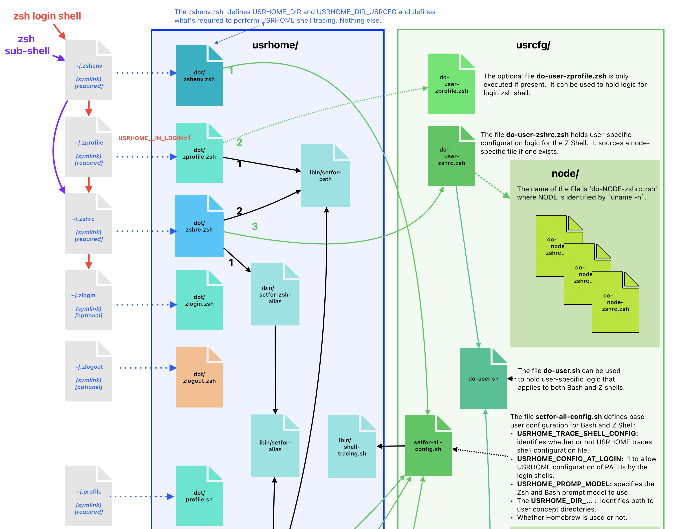

- The ``~/zshenv`` is sourced in all case.  Therefore the
  `usrhome/dot/zshenv.zsh`_ sources the user's basic configuration file
  (``usrcfg/setfor-all-config.sh``) that identifies the main USRHOME
  configuration features.
- The file `usrhome/ibin/setfor-path`_ controls adding extra directories in the
  PATH; the directories used by USRHOME and some other.  That file is
  optionally sourced  by the `usrhome/dot/zprofile.zsh`_ for a login shell and by the
  usrhome/dot/zshrc.zsh in a sub-shell.  For the login shell the PATH is
  modified only when the USRHOME_CONFIG_AT_LOGIN variable is set to 1.
- Since the `usrhome/dot/zshrc.zsh`_ is used both in the login and the sub-shell,
  it's the file that sources the `usrhome/ibin/setfor-zsh-alias`_ to inject
  the USRHOME alias commands and sell functions inside the shell.
  That file also attempts to sanitize PATH.  When sanitization changes PATH,
  an interactive shell prints a warning unless TERM is ``dumb``.  Check your
  configuration files or the application that launched the sub-shell if
  this warning appears.

The user can provide extra startup logic for the Z Shell.  USRHOME Z Shell
startup code sources the following user configuration files stored in the user
managed usrcfg directory:

- usrcfg/do-user-zprofile.zsh
- usrcfg/do-user-zshrc.zsh

Each of these files is sourced if they exist. In turn these files could source
files for the specific node if the user wants to support several hosts.  The
diagram shows the order in which the files are sourced.

The Z and Bash Shell Startup, Dot Files and User Configuration
--------------------------------------------------------------

USRHOME supports the Bash and the Z shell and currently concentrates on
using these shells on user development computers (as opposed to servers).
To support both shells, more configuration files are
required and some logic is the same for both shells.  The following diagram
shows all files currently used in the USRHOME system to support both shells.

USRHOME is built on the principle that shell configuration logic is provided by
**two** sets of files:

- the files provided by the USRHOME repository, and
- the files provided by another, user-provided, repository: the **usrcfg**
  repository.

The files provided by USRHOME provides the basic infra-structure logic and some
commands that will be available in the shells.  The content of the files are not
meant to be modified by the users (unless someone wants to change or add a
feature to USRHOME).

The user-specific logic is stored in the files stored in the **usrcfg**
directory tree.

Since the reason for the USRHOME project is to ease the shell configuration
setup and distribution of many computers or Virtual Machines without *having* to
use containers, the **usrcfg** directory tree should also be a VCS repository
controlled by the user (and kept private).  It then becomes possible to keep an
history of the shell configuration of multiple computers inside these 2
repositories and it becomes easy to set computers by cloning or updating the two
repositories inside these computers.

The **usrcfg** stores logic that is common to all the users system in the files
located in its root directory.  The logic that is specific to each computer must
be stored inside a sub-directory of the **usrcfg/node** directory.

The following diagram shows which configuration file is sourced when the Bash
and Z shell start as a login or as a sub-shell.

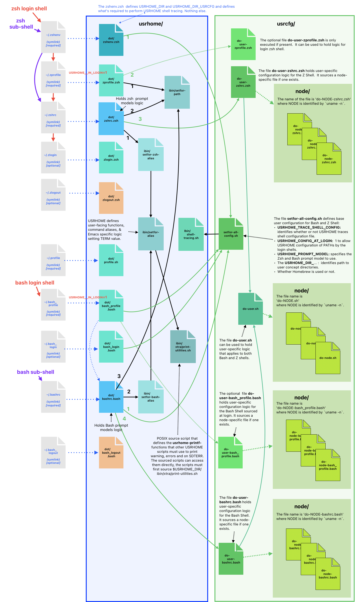


Shell Startup File Execution Sequences
--------------------------------------

Activate startup file tracing by setting ``USRHOME_TRACE_SHELL_CONFIG`` to 1
inside your ``$USRHOME_DIR_USRCFG/setfor-all-config.sh`` file.
Set it to 0 to prevent tracing.


Bash login shell execution sequence
~~~~~~~~~~~~~~~~~~~~~~~~~~~~~~~~~~~

- ~/.bash_profile  --> $USRHOME_DIR/dot/bash_profile.bash

  - $$USRHOME_DIR_DIR_USRCFG/setfor-all-config.sh  *(must exist!)*

    - $$USRHOME_DIR_DIR_USRCFG/do-user-bash_profile.bash

- ~/.bashrc        --> $USRHOME_DIR/dot/bashrc.bash

  - $USRHOME_DIR/ibin/setfor-bash-alias

    - $USRHOME_DIR/ibin/setfor-alias

  - $USRHOME_DIR/ibin/setfor-path

    - $USRHOME_DIR/ibin/envfor-homebrew
    - $USRHOME_DIR/ibin/envfor-usrhome

  - $USRHOME_DIR_USRCFG/do-user-bashrc.bash  *(if it exists)*

    - $USRHOME_DIR_USRCFG/do-user.sh   *(if it exists)*

Z Shell login shell execution sequence
~~~~~~~~~~~~~~~~~~~~~~~~~~~~~~~~~~~~~~

- ~/.zshenv    --> $USRHOME_DIR/dot/zshenv.zsh

  - $USRHOME_DIR_USRCFG/setfor-all-config.sh  *(must exist)*

- ~/.zprofile  --> $USRHOME_DIR/dot/zprofile.zsh

  - $USRHOME_DIR/ibin/setfor-path
  - $USRHOME_DIR_USRCFG/do-user-zprofile.zsh

- ~/.zshrc     --> $USRHOME_DIR/dot/zshrc.zsh

  - $USRHOME_DIR/ibin/setfor-zsh-alias

    - $USRHOME_DIR/ibin/setfor-alias

  - $USRHOME_DIR/ibin/setfor-path

    - $USRHOME_DIR/ibin/envfor-homebrew
    - $USRHOME_DIR/ibin/envfor-usrhome

  - $USRHOME_DIR_$USRHOME_DIR_USRCFG/do-user-zshrc.zsh  *(must exist)*

    - $USRHOME_DIR_$USRHOME_DIR_USRCFG/do-user.sh  *(must exist)*

- ~/.zlogin    --> $USRHOME_DIR/dot/zlogin.zsh

Activate Tracing of the Sourcing of the Shell Configuration Files
-----------------------------------------------------------------

By setting the value of ``USRHOME_TRACE_SHELL_CONFIG`` to 1 inside your
``usrcfg/setfor-all-config.sh`` file you activate USRHOME's shell
configuration file tracing.  Then when
you open a new shell inside a terminal, or create a sub-shell, you can see
which file is sourced.

You can also set the value of ``USRHOME_TRACE_SHELL_CONFIG`` to the name of a
file located inside an existing directory.  That activates the tracing to the
shell stdout as for the value ``1`` but it also activates storing the trace
lines inside the specified file.

With all usrcfg files existing, this is what you'd see from macOS that uses the Z
Shell as the default shell when you open a new terminal and then create a
sub-shell inside it.  The name of the environment variables are shown instead
of the real path.

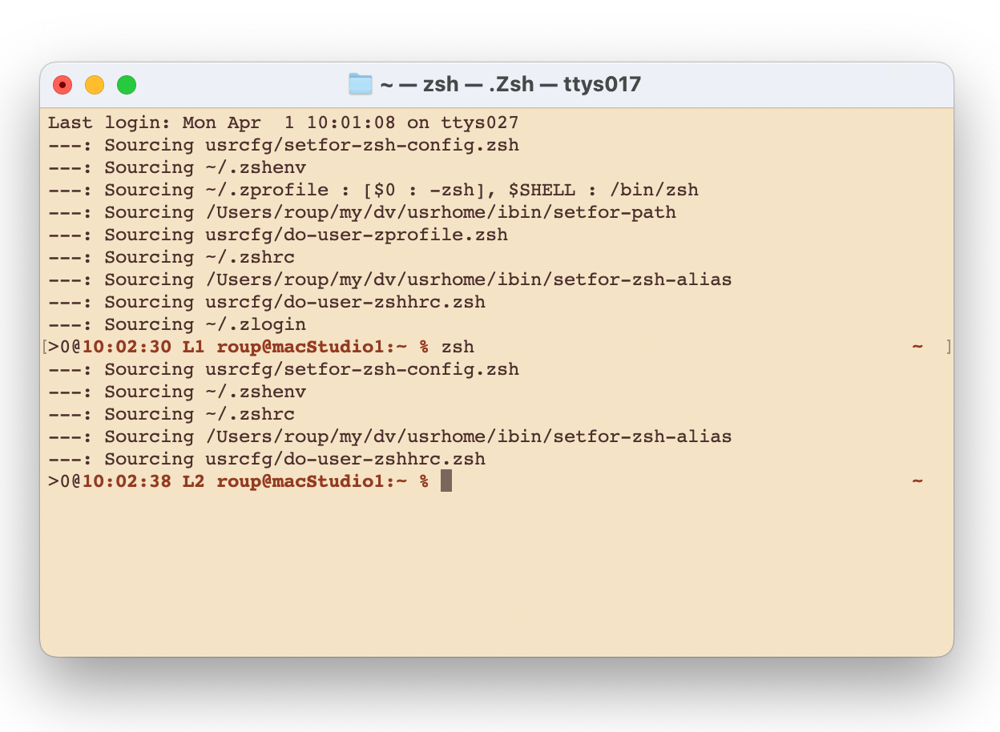

For comparison, here's the same inside shells started from within a terminal
based instance of Emacs with two shells, one running inside a shell-mode
buffer and another inside a term-mode buffer.  Notice that the Z Shell started
inside Emacs are sub-shells and therefore only execute the corresponding Z Shell
configuration files for that.

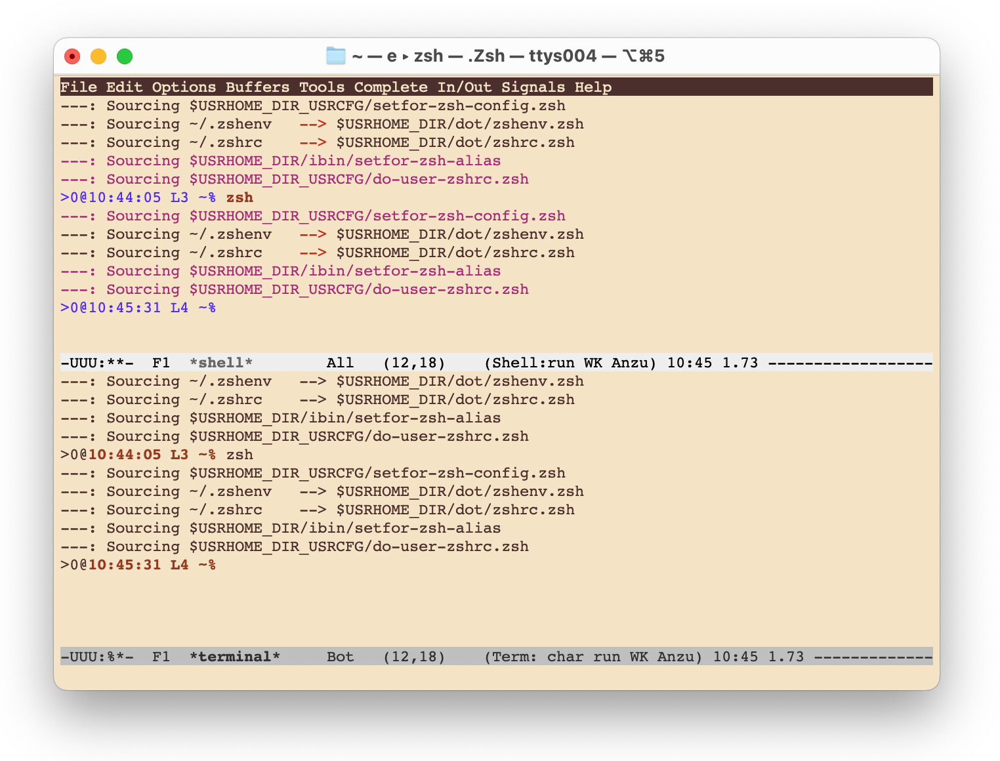

From a graphical version of Emacs started from the system (and not from a
shell):

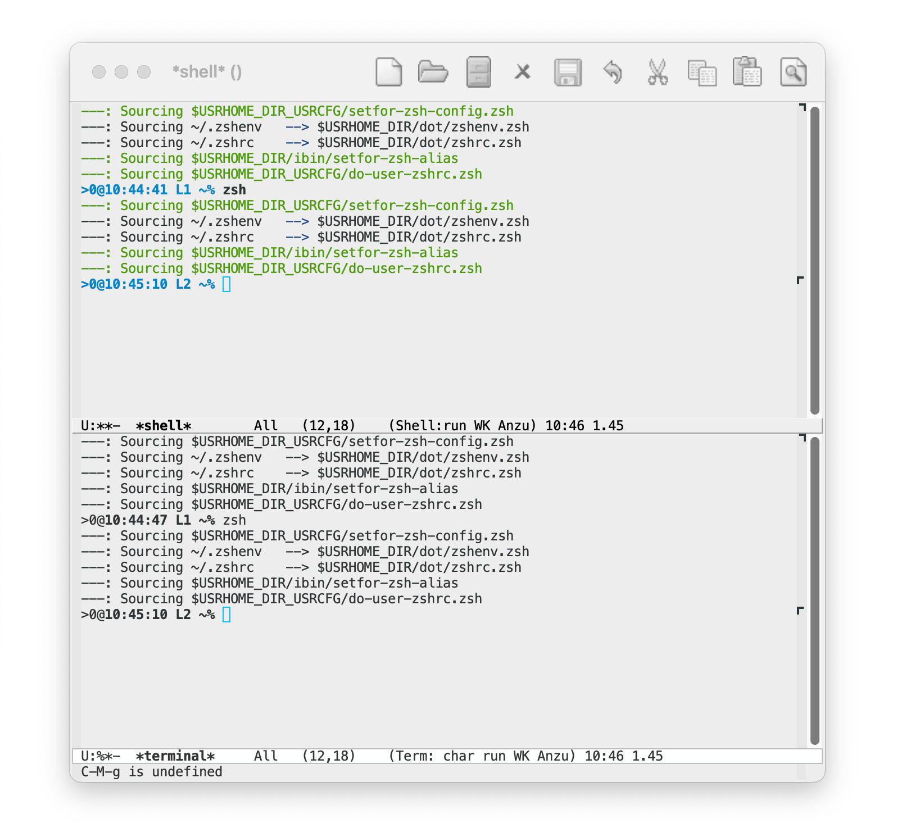

And a version of Aquamacs_ started from the system.  In that case you can see
that the USRHOME logic detects and reports redundant entries in the PATH that
is injected by the Aquamacs logic and then corrects them.

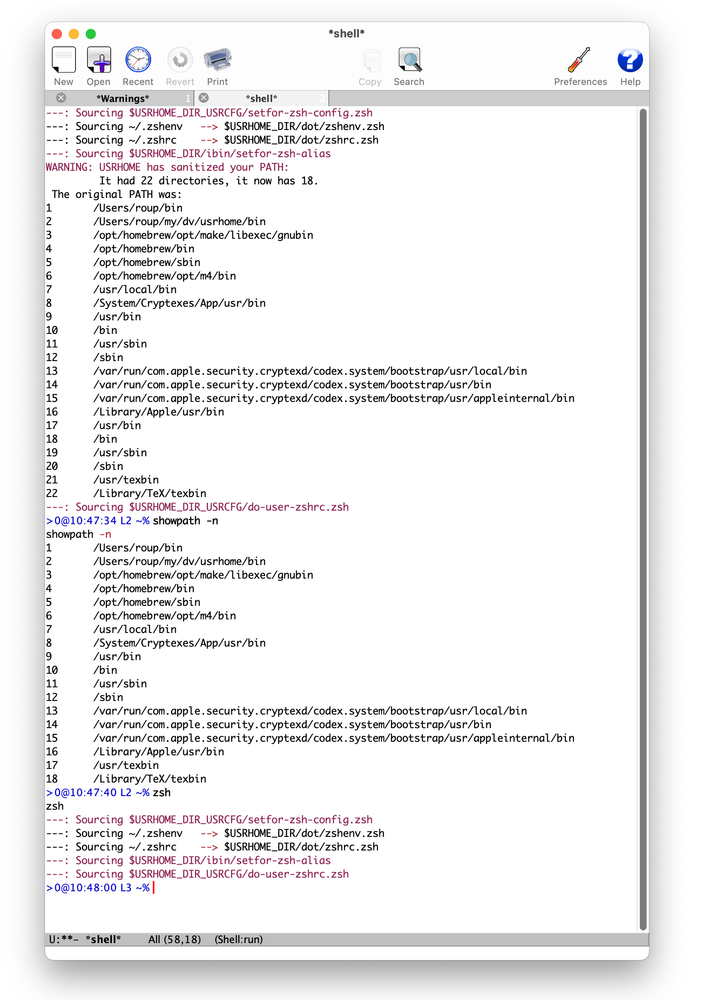

When the USRHOME_TRACE_SHELL_CONFIG is set to ``0`` instead of ``1``, USRHOME
startup configuration files do not display the entire warning. It just
mentions that USRHOME sanitized the PATH and how to see more as we can see here:

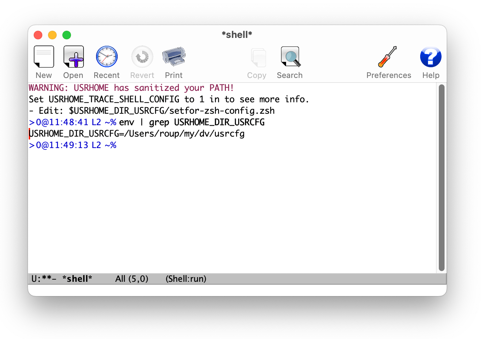


Setup Examples
==============

Here's two screen captures of USRHOME taken on macOS Sonoma and Rocky Linux
9.3.

macOS shells
------------

The macOS Sonoma default shell is zsh. I have installed the latest Bash
shell via Homebrew and also installed Rust.   These are available on the
default zsh shell, which is shown starting in the first terminal seen in the
back (ttys013).  The PATH available in that shell has 17 entries.  It has
access to Rust and several Homebrew directories.

I have also configured Terminal to start a Bash login shell. That shell
(ttys014) is
also controlled by USRHOME but my USRHOME setting prevents USRHOME to add
anything on the PATH of the login shells.  They have 10 directories in their
PATH; the first one being ``/usr/local/bin``.

Then I start another terminal (ttys015) with macOS default zsh non-login
interactive shell.   As for the first one (ttys013), it sets up Homebrew and
Rust because my USRHOME setup is done that way for those shells.  It has 17
directories in PATH.  Then I create a Bash sub-shell.  You can see it in the
prompt.  The ``L2`` is the value of the ``SHLVL`` variable identifying the
shell nested level.  From bash I create a zsh sub-shell from where I launch a
``sleep 100`` command in the background.  The zsh shows ``1 ⚙`` identifying a
running background job.  And when I issue an invalid command, it prints the
exit code (127) followed by a red ⨯.

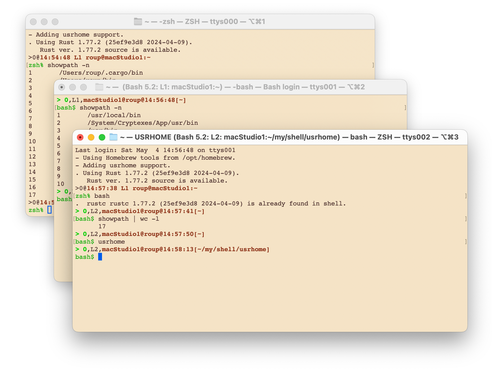

Rocky Linux 9.3 shell
---------------------

The screen shot show a setting I have for Rocky Linux 9.3.  Rocky Linux 9.3
default shell is Bash 5.1. Again here I
started two terminal instances: the first one launches the default Bash,
instrumented with the exact same USRHOME settings than my macOS one.
On Linux, Homebrew is not used.  But it also activates Rust.

USRHOME does some check for vulnerabilities and it detects a possible one in
Rocky Linux 9.3 and reports it when it is executing as the first level.
The prompt prints:

- the exit code of the last command,
- the elapsed time (duration) of the completed command,
- the shell nested level,
- the number of background jobs running,
- the user name @ hostname @ current time in 24-hour format
- the current directory in side square brackets.

The second non-login shell is executing a terminal-based Emacs process, which
runs a terminal mode shell.  The USRHOME shell is Emacs-aware.
The bash prompt is not affected when running inside Emacs.
It can display the same information.
You can see the PATH components shown by the showpath command.

USRHOME will sanitize and report sloppy PATH such as PATH with duplicate
entries and empty entries. Here everything is fine.

When the shell is placed in sudo mode, the prompt changes color and shows a
``#`` instead of a ``$`` after the word ``bash``.

The third terminal is configured to launch Bash in login mode. Here, USRHOME
does not add anything to the PATH; the Bash login shells are unmodified and do
not have access for any extra tools, therefore the PATH is shorter.
These shells do not perform USRHOME simple (and quite limited) vulnerability
check.

Also note that, to help distinguish the login shell, I set the login shell
prompt to red and the color of the non-login prompt to blue.

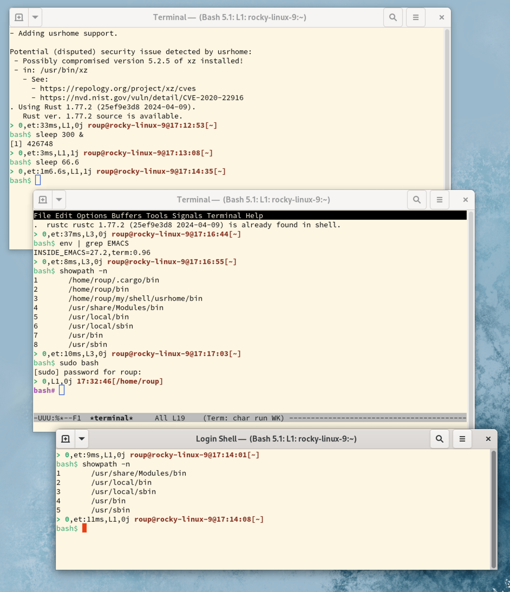


Kali Linux zsh shells with tracing enable
-----------------------------------------

You can activate shell tracing with USRHOME.
When enabled, the shell prints what file is sourced when the shell starts,
as this is shown in the Kali Linux, where zsh is the default shell.

Rust is not installed in that system but it uses the same USRHOME
*common* configuration as the others (with the temporary exception of enabling
tracing) and the shell prints a warning.

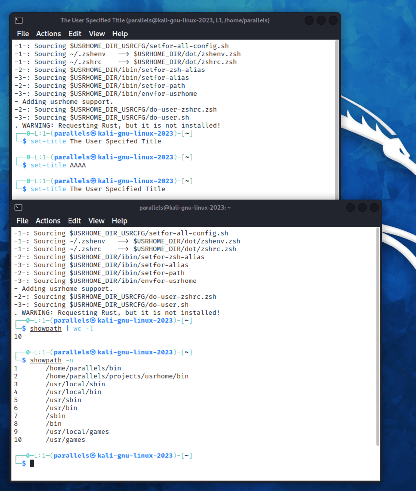

It would be possible to move the request to use Rust from the common
configuration file (in this case the file usrcfg/do-user.sh, that has logic
similar to the `example template file for do-user.sh`_ ) into a
node-specific file that the usrcfg logic could identify.  That could be done
by the do-user.sh in the way that the `usrcfg do-user-zshrc.sh example file
does`_.


Adding Your Own Environment Customization to your Shell
=======================================================

You will most probably want to add features to your shells, over what USRHOME
provides. USRHOME provides several mechanism to do that, described in the
following sections with examples and files located in the setup/template
directory you can use as examples.

The use- commands -- Inject something in your local shell
---------------------------------------------------------

The idea here is to provide a set of sourced scripts and corresponding
commands to source them.  One set for each feature you want to inject into
your shell.  Something like providing access to a different implementation of
a command available to the Operating System, or adding support for the tools
required for a programming language.

The method:

- Add a ``use-ENV`` alias command that sources a ``envfor-ENV`` script,
  where ``ENV`` is the name of the environment concept.
- Add the alias statement into the usrcfg/do-user-zshrc.zsh file.
  Store the ``envfor-ENV`` script inside the usrcfg directory.

Examples follow.

use-curl-hb -- Activate Homebrew version of curl in the current shell.
~~~~~~~~~~~~~~~~~~~~~~~~~~~~~~~~~~~~~~~~~~~~~~~~~~~~~~~~~~~~~~~~~~~~~~

The version of curl_ available on macOS is often relatively old and may not
incorporate the latest vulnerability fixes. You may want to install the
latest available from Homebrew_ but once you install it it will warn you
that installing it permanently might cause problems with macOS.

A solution to this is to install the files ion your system but not install
the symlinks and not put it your your system's PATH. Homebrew does that.
Now if you want to use Homebrew's version of curl you need to ensure that it
will be piked up in the PATH before the system's one.

To do that we can place the following statement inside the
usrcfg/do-user-zshrc.zsh file:

.. code:: shell

          alias use-curl-hb='. $USRHOME_DIR_USRCFG/envfor-curl-hb'

And we store the logic we need into the usrcfg/envfor-curl-hb file.
In this specific case, there's not much.  Just this:

.. code:: shell

          export PATH="/opt/homebrew/opt/curl/bin:$PATH"

When we open a new Z Shell we can see the impact:

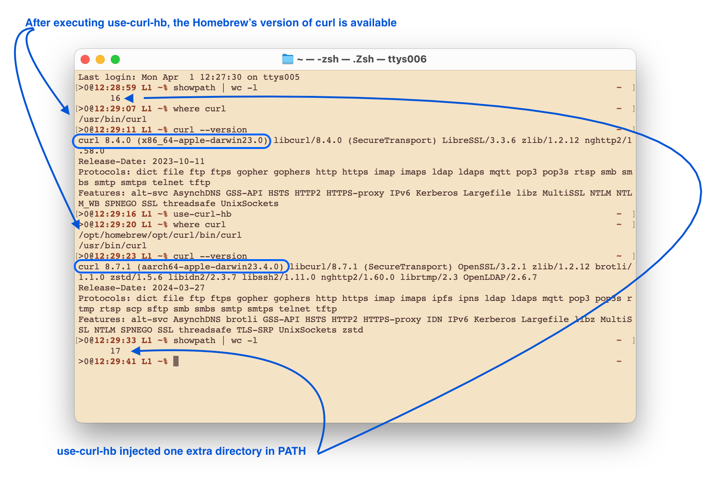

There's **no** impact in any other shells, and macOS continues to use its own
version of curl.  You can open another shell and it will use the native
version unless you execute the ``use-curl-hb`` command.


use-rust -- Activate Rust programming environment in current shell
~~~~~~~~~~~~~~~~~~~~~~~~~~~~~~~~~~~~~~~~~~~~~~~~~~~~~~~~~~~~~~~~~~

If you want to use the Rust_ programming language you most probably need to
install it in your system.  The default mechanism is to install it in the
system and each shell will have access to it.  You may also want to only limit
it to one given shell and start all tools from that shell (or shells).  That
what the ``use-rust`` command will do.

The first step is to install Rust_ and Cargo as described in it the
`Rust installation procedure`_, with::

  curl https://sh.rustup.rs -sSf | sh

Once it's done, you can use the ``git diff`` command to see what that changed
into your shell configuration that is now stored inside the USRHOME directory
tree.

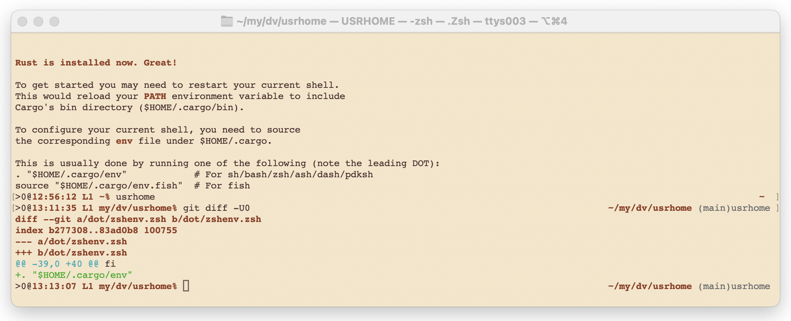

The Rust installation added the sourcing of "$HOME/.cargo/env" to your
USRHOME ``dot/zshenv.zsh`` file.  Recall that the ``~/.zshenv`` now the
USRHOME ``dot/zshenv.zsh``  is sourced every time a terminal opens a shell, at
the beginning, before everything else.  It also sources it when a sub-shell is
opened.  Looking into the ``$HOME/.cargo/env`` we can see that it
conditionally prepends the ``$HOME/.cargo/bin`` directory to the PATH.  At
least it won't do it several times.  But if you append that inside your Z
Shell configuration it will be available to all processes once you restart
your system.  It might be what you want. Or not.

If you just want to add Rust support in selected shells, then create a
``use-rust`` command.

- Remove the extra code that was appended to your
  USRHOME ``dot/zshenv.zsh`` file and place it inside a
  ``envfor-rust`` script located inside your usrcfg directory.
  At the same time add a little bit more to provide more info:


  .. code:: shell

            . "$HOME/.cargo/env"
            rustv="$(rustc --version)"
            echo "--- Rust $rustv Installed in shell"

- Add the ``use-rust`` alias to your
  usrcfg/do-user-zshrc.zsh file:

  .. code:: shell

            alias use-rust='. $USRHOME_DIR_USRCFG/envfor-rust'


Now you can inject Rust support by executing the ``use-rust`` command:

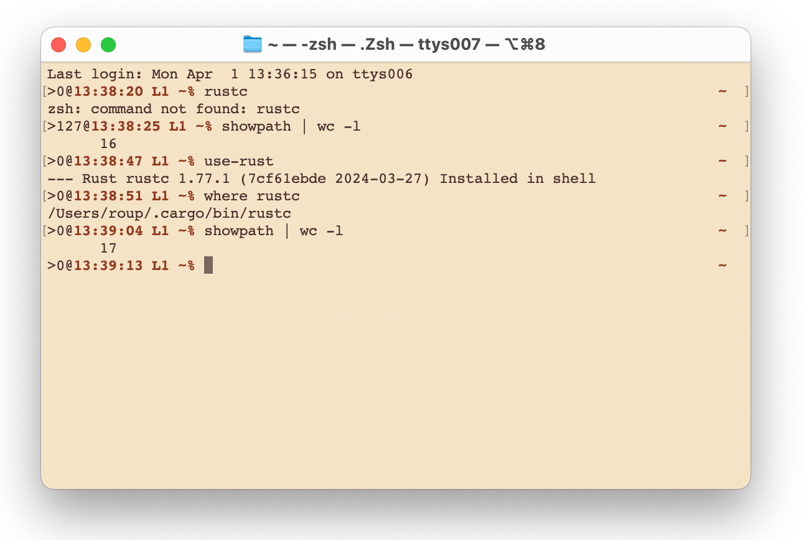

As you can see no change is required in the files supplied by the USRHOME
project.  The customization is done inside your files, located in the usrcfg
directory tree.  That directory tree should also be under the control of a
version control system, like Git or anything else.  I also use Mercurial_ for
that purpose as you can see below.


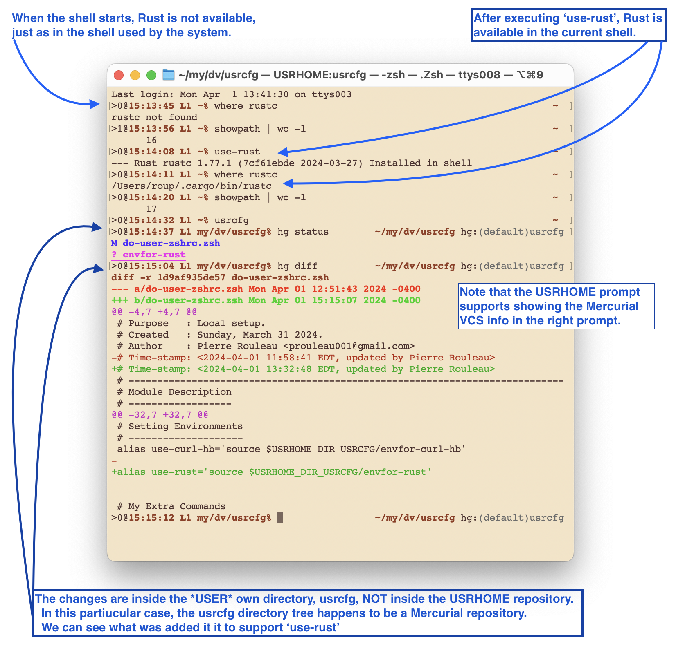


Adding Permanent Environments to all Shells
-------------------------------------------

In some cases you may decide to add a feature to the system shell and all
shell instances. This way you won't have to type the required ``use-`` command
into each shell that requires it.

You can do that too with USRHOME. And there are several ways to do it; add the
sourcing of the corresponding ``envfor-`` file from one of the ``.zsh`` files
in the usrcfg.
Usually you will probably want to do that from the ``usrcfg/do-user-zshrc.zsh``.

With envfor-rust sourced inside the ``usrcfg/do-user-zshrc.zsh`` file, Rust
support is installed automatically inside all shells, including the system
Z Shell as we can see:

- from a Z Shell launched from Terminal.app:

  .. figure:: res/use-rust-03.png

- from a Z Shell opened inside a shell-mode terminal-type Emacs buffer:

  .. figure:: res/use-rust-in-e.png

- from a Z Shell opened inside a shell-mode graphical-type Emacs buffer:

  .. figure:: res/use-rust-in-ge.png

- from a Z Shell opened inside a shell-mode Aquamacs buffer:

  .. figure:: res/use-rust-in-aquamacs.png

Using USRHOME on Kali Linux
===========================

Kali Linux uses zsh as the default shell.
It has it's own prompt definition with  several Z Shell extensions
enabled, which the USRHOME default shell does not have yet.

You can still use USRHOME on Kali Linux and take advantage of the USRHOME commands
and philosophy of storing the USRHOME main code and the local shell
customization inside the usrcfg directory.  That can also be stored inside a
repository.  In this example, the usrcfg files are stored inside my **local**
Mercurial repository.  The logic in the various files support multiple target
environment, which they select by checking the host name and other values.

This way, I can **centralize the shell setting of all computers or VMs** I use
inside **a single repository** that I clone inside the usrcfg directory of these
computers and VMs.  I can design the logic once, specialize it for various
environments and distribute it through the VCS.

Here's a Kali Linux terminal with the Z shell using USRHOME selecting the
original Kali Linux Z Shell configuration (moved into the
``usrcfg/do-user-zshrc.zsh`` file and selected based on the USRHOME prompt
model value):

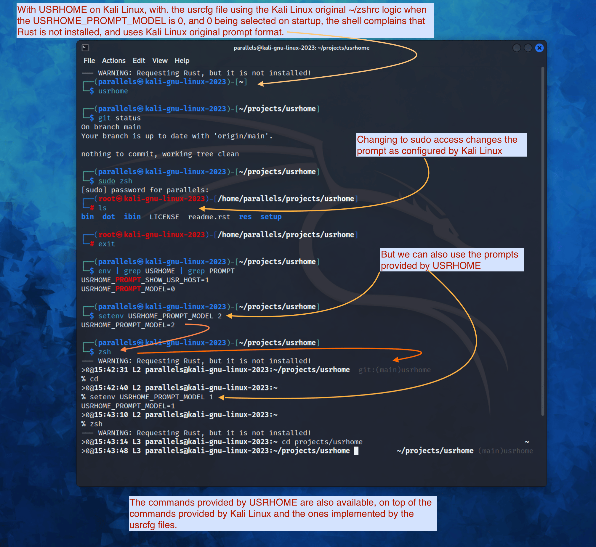

And then, after changing the color scheme of Kali Linux terminal, two
terminals, one running the terminal version of Emacs launched with an alias to
``emacs -nw`` and the graphical version of Emacs launched from the shell with a shell
function that captures the current working directory and runs in background.
You can see the prompts inside the Emacs shell-mode and term-mode buffers.


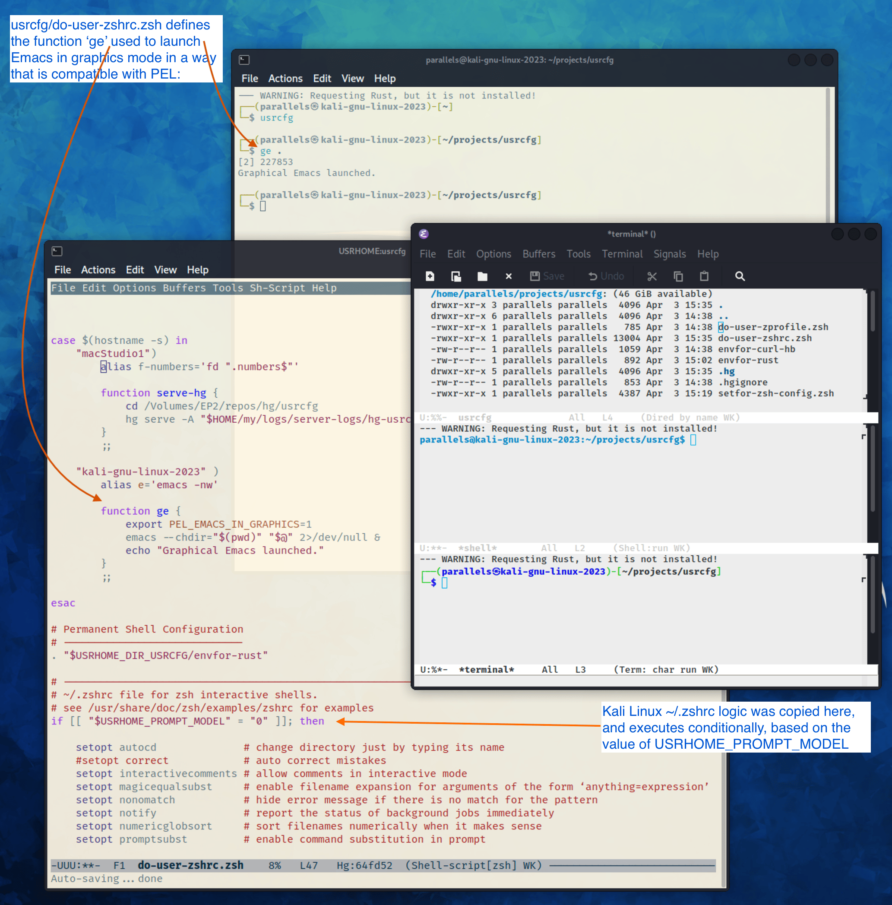


Using USRHOME on macOS
======================

On macOS several tools that are available on Linux are missing.

I am using Homebrew_ to install these tools.  When used on macOS running on
Apple Silicon CPU, Homebrew_ does require sudo access because it places all
files inside the ``/opt/homebrew`` directory tree, with ``/opt/homebrew/bin``
the location of the executable files (or symlinks to the executable files).
This directory is not on PATH unless you place it.  USRHOME adds it for macOS.

USRHOME provides several features to enhance the command line experience on
macOS without affecting macOS default environment.  It becomes possible to use
macOS as it was when first installed or use it with the USRHOME provided
features inside the USRHOME extended shells.

More information about the extra features are described in the following
sections.

Using GCC on macOS
------------------

The following commands specializes the shell to use a specific version of the
GCC tool chain inside the shell.  That shell can then build using the specified
tool chain instead of the Apple-supplied Clang tool chain.

= ===================================== =============================================================
. Command                               Description
= ===================================== =============================================================
. ``use-gcc14 [--quiet]``               Installs GCC 14 tool chain inside the current directory.

                                        - By default it is a little verbose, printing the actual
                                          version of GCC installed, the resulting PATH and MANPATH.
                                          You can use the ``--quiet`` option; it will only print one
                                          line.
                                        - It can only be executed once inside a shell.  It will print
                                          an error if you try to run it again.
                                        - It requires a ``~/bin`` directory to exists.
                                        - The first time executed, it checks for the presence of a
                                          ``~/bin/gcc-14`` directory and other files.  If these are
                                          not found, it will print an error message showing that you
                                          must execute the script `create-gcc-as-gcc14.sh`_.

                                          - `create-gcc-as-gcc14.sh`_ checks the requirements, which
                                            includes the Homebrew-installed GCC 14.  If it is not
                                            found the script will tell you to install it with
                                            the ``brew install gcc@14`` command.
                                          - Once this is done it will create the required symbolic
                                            link files inside your ``~/bin/gcc-14`` directory which
                                            will later be placed in your PATH.
                                          - Upon success, `create-gcc-as-gcc14.sh`_ will instruct you
                                            to execute ``use-gcc14`` again.

                                        - The ``use-gcc14`` command is a an alias that sources the
                                          `usrhome/ibin/envfor-gcc14-on-macos`_ script.  That script
                                          puts the ``~/bin/gcc-14`` at the beginning of the shell's
                                          PATH, effectively activating the GCC commands.
= ===================================== =============================================================


.. ---------------------------------------------------------------------------

Notes
=====

.. [#pike_note] Although `Pike`_ is not deployed in most system it is easy to setup and use.
           It's also not necessary if you do not use that simple command.


Feedback's Welcome!
===================

If you stumble on this page and find this project interesting but falling
short somewhere, let me know.  Create an issue or propose a change or addition
through a pull-request.

Thanks!

.. ---------------------------------------------------------------------------
.. links


.. _PEL:
.. _Pragmatic Emacs Library:                           https://github.com/pierre-rouleau/pel#readme
.. _numeric keypad:                                    https://raw.githubusercontent.com/pierre-rouleau/pel/master/doc/pdf/numkeypad.pdf
.. _fd:                                                https://github.com/sharkdp/fd#readme
.. _The Z Shell Startup, Dot Files and User Configuration: #the-z-shell-startup-dot-files-and-user-configuration
.. _Z Shell:                                           https://en.wikipedia.org/wiki/Z_shell
.. _files sourced by the Z Shell:                      https://raw.githubusercontent.com/pierre-rouleau/pel/master/doc/pdf/lang/zsh.pdf
.. _Aquamacs:                                          https://aquamacs.org
.. _curl:                                              https://en.wikipedia.org/wiki/CURL
.. _Homebrew:                                          https://en.wikipedia.org/wiki/Homebrew_(package_manager)
.. _Rust:                                              https://en.wikipedia.org/wiki/Rust_(programming_language)
.. _Rust installation procedure:                       https://doc.rust-lang.org/cargo/getting-started/installation.html
.. _Mercurial:                                         https://en.wikipedia.org/wiki/Mercurial
.. _manpath:                                           https://man7.org/linux/man-pages/man1/manpath.1.html
.. _pngquant:                                          https://pngquant.org/
.. _xz version 5.6.0 and 5.6.1:                        https://nvd.nist.gov/vuln/detail/CVE-2024-3094
.. _xz version 5.2.5:                                  https://nvd.nist.gov/vuln/detail/CVE-2020-22916
.. _man (or woman):                                    https://www.gnu.org/software/emacs/manual/html_node/emacs/Man-Page.html#Man-Page
.. _PDF index:                                         https://raw.githubusercontent.com/pierre-rouleau/pel/master/doc/pdf/-index.pdf
.. _help PDF:                                          https://raw.githubusercontent.com/pierre-rouleau/pel/master/doc/pdf/help.pdf
.. _section that describe Emacs man and woman support: https://raw.githubusercontent.com/pierre-rouleau/pel/master/doc/pdf/help.pdf#page=5
.. _emacsclient:                                       https://www.gnu.org/software/emacs/manual/html_node/emacs/Invoking-emacsclient.html
.. _Emacs 'string-format' regular expression syntax:   https://raw.githubusercontent.com/pierre-rouleau/pel/master/doc/pdf/search-replace.pdf#page=9
.. _glob:                                              https://en.wikipedia.org/wiki/Glob_(programming)
.. _usrhome/template/usrcfg/ibin:                      https://github.com/pierre-rouleau/usrhome/tree/main/template/usrcfg/ibin
.. _cbr command:
.. _use-cbr command:                                   `CBR -- Single commands to Check, Build or Run`_
.. _use-emacs-for-man command:                         `Using Emacs as a man reader`_
.. _USRHOME dot files:                                 https://github.com/pierre-rouleau/usrhome/tree/main/dot
.. _do-add-to-path:                                    https://github.com/pierre-rouleau/usrhome/blob/main/ibin/do-add-to-path
.. _do-cbr:                                            https://github.com/pierre-rouleau/usrhome/blob/main/ibin/do-cbr
.. _cd-to:
.. _do-cd-to:                                          https://github.com/pierre-rouleau/usrhome/blob/main/ibin/do-cd-to
.. _do-clrenv:                                         https://github.com/pierre-rouleau/usrhome/blob/main/ibin/do-clrenv
.. _xtra/sanitize-path-posix.sh:                       https://github.com/pierre-rouleau/usrhome/blob/main/ibin/xtra/sanitize-path-posix.sh
.. _do-setenv:                                         https://github.com/pierre-rouleau/usrhome/blob/main/ibin/do-setenv
.. _do-usrcfg:                                         https://github.com/pierre-rouleau/usrhome/blob/main/ibin/do-usrcfg
.. _do-usrhome:                                        https://github.com/pierre-rouleau/usrhome/blob/main/ibin/do-usrhome
.. _dot/zshrc.zsh:                                     https://github.com/pierre-rouleau/usrhome/tree/main/dot/zshrc.zsh
.. _envfor-cbr:                                        https://github.com/pierre-rouleau/usrhome/blob/main/ibin/envfor-cbr
.. _envfor-emacs-for-man:                              https://github.com/pierre-rouleau/usrhome/blob/main/ibin/envfor-emacs-for-man
.. _envfor-pel:                                        https://github.com/pierre-rouleau/usrhome/blob/main/ibin/envfor-pel
.. _envfor-gnu-global:                                 https://github.com/pierre-rouleau/usrhome/blob/main/ibin/envfor-gnu-global
.. _setfor-alias:                                      https://github.com/pierre-rouleau/usrhome/blob/main/ibin/setfor-alias
.. _setfor-bash-alias:                                 https://github.com/pierre-rouleau/usrhome/blob/main/ibin/setfor-bash-alias
.. _setfor-path:                                       https://github.com/pierre-rouleau/usrhome/blob/main/ibin/setfor-path
.. _setfor-zsh-alias:                                  https://github.com/pierre-rouleau/usrhome/blob/main/ibin/setfor-zsh-alias
.. _setup/setup-usrhome:                               https://github.com/pierre-rouleau/usrhome/blob/main/setup/setup-usrhome
.. _usrhome/ibin/shell-tracing.sh:                     https://github.com/pierre-rouleau/usrhome/blob/main/ibin/shell-tracing.sh
.. _shell-tracing.sh:                                  https://github.com/pierre-rouleau/usrhome/blob/main/ibin/shell-tracing.sh
.. _usrcfg/setfor-all-config.sh:                       https://github.com/pierre-rouleau/usrhome/blob/main/template/usrcfg/setfor-all-config.sh
.. _usrhome/ibin/setfor-zsh-alias:                     https://github.com/pierre-rouleau/usrhome/blob/main/ibin/setfor-zsh-alias
.. _usrhome/ibin/setfor-path:                          https://github.com/pierre-rouleau/usrhome/blob/main/ibin/setfor-path
.. _usrhome/dot/zprofile.zsh:                          https://github.com/pierre-rouleau/usrhome/blob/main/dot/zprofile.zsh
.. _usrhome/dot/zshenv.zsh:                            https://github.com/pierre-rouleau/usrhome/blob/main/dot/zshenv.zsh
.. _usrhome/dot/zshrc.zsh:                             https://github.com/pierre-rouleau/usrhome/blob/main/dot/zshrc.zsh
.. _usrhome/dot/bash_profile.bash:                     https://github.com/pierre-rouleau/usrhome/blob/main/dot/bash_profile.bash
.. _usrhome/dot/zprofile.zsh:                          https://github.com/pierre-rouleau/usrhome/blob/main/dot/zprofile.zsh
.. _usrhome/dot:                                       https://github.com/pierre-rouleau/usrhome/tree/main/dot
.. _usrhome/ibin/envfor-emacs-for-man:                 https://github.com/pierre-rouleau/usrhome/blob/main/ibin/envfor-emacs-for-man
.. _usrhome/template/bin/ge:                           https://github.com/pierre-rouleau/usrhome/blob/main/template/bin/ge
.. _usrhome/template/setfor-all-config.sh:             https://github.com/pierre-rouleau/usrhome/blob/main/template/usrcfg/setfor-all-config.sh
.. _usrcfg template files:                             https://github.com/pierre-rouleau/usrhome/blob/main/template/usrcfg
.. _usrhome/template:                                  https://github.com/pierre-rouleau/usrhome/blob/main/template
.. _which-shell:                                       https://github.com/pierre-rouleau/usrhome/blob/main/ibin/which-shell
.. _cd-to command:                                     `Directory Navigation`_
.. _usrcfg command:                                    `Directory Navigation`_
.. _usrhome command:                                   `Directory Navigation`_
.. _pel command:                                       `Directory Navigation`_
.. _add-to-path command:
.. _clrenv command:                                    `Command to Display and Manipulate Environment Variables`_
.. _sanitize-path command:                             `Command to Display and Manipulate Environment Variables`_
.. _setenv command:                                    `Command to Display and Manipulate Environment Variables`_
.. _profile.sh:                                        https://github.com/pierre-rouleau/usrhome/blob/main/dot/profile.sh
.. _bash_profile.bash:                                 https://github.com/pierre-rouleau/usrhome/blob/main/dot/bash_profile.bash
.. _bash_login.bash:                                   https://github.com/pierre-rouleau/usrhome/blob/main/dot/bash_login.bash
.. _bashrc.bash:                                       https://github.com/pierre-rouleau/usrhome/blob/main/dot/bashrc.bash
.. _bash_logout.bash:                                  https://github.com/pierre-rouleau/usrhome/blob/main/dot/bash_logout.bash
.. _zshenv.zsh:                                        https://github.com/pierre-rouleau/usrhome/blob/main/dot/zshenv.zsh
.. _zprofile.zsh:                                      https://github.com/pierre-rouleau/usrhome/blob/main/dot/zprofile.zsh
.. _zshrc.zsh:                                         https://github.com/pierre-rouleau/usrhome/blob/main/dot/zshrc.zsh
.. _zlogin.zsh:                                        https://github.com/pierre-rouleau/usrhome/blob/main/dot/zlogin.zsh
.. _zlogout.zsh:                                       https://github.com/pierre-rouleau/usrhome/blob/main/dot/zlogout.zsh
.. _envfor-diff:                                       https://github.com/pierre-rouleau/usrhome/blob/main/ibin/envfor-diff
.. _use-diff command:                                  `File Diff Operations`_
.. _Rosetta 2:                                         https://eclecticlight.co/2021/01/22/running-intel-code-on-your-m1-mac-rosetta-2-and-oah/
.. _example template file for do-user.sh:              https://github.com/pierre-rouleau/usrhome/blob/main/template/usrcfg/do-user.sh#L72
.. _usrcfg do-user-zshrc.sh example file does:         https://github.com/pierre-rouleau/usrhome/blob/main/template/usrcfg/do-user-zshrc.zsh#L55
.. _usrcfg/setfor-all-config.sh:                       https://github.com/pierre-rouleau/usrhome/blob/main/template/usrcfg/setfor-all-config.sh
.. _usrcfg/do-user-zprofile.zsh:                       https://github.com/pierre-rouleau/usrhome/blob/main/template/usrcfg/do-user-zprofile.zsh
.. _usrcfg/do-user-zshrc.zsh:                          https://github.com/pierre-rouleau/usrhome/blob/main/template/usrcfg/do-user-zshrc.zsh
.. _usrcfg/do-user-bash_profile.bash:                  https://github.com/pierre-rouleau/usrhome/blob/main/template/usrcfg/do-user-bash_profile.bash
.. _usrcfg/do-user-bashrc.bash:                        https://github.com/pierre-rouleau/usrhome/blob/main/template/usrcfg/do-user-bashrc.bash
.. _usrhome-shell-toggle-tracing:                      https://github.com/pierre-rouleau/usrhome/blob/main/ibin/setfor-shell-toggle-tracing
.. _usrhome-prompt-toggle-usr-host:                    https://github.com/pierre-rouleau/usrhome/blob/main/ibin/setfor-prompt-toggle-usr-host
.. _usrhome-prompt-model-to:                           https://github.com/pierre-rouleau/usrhome/blob/main/ibin/setfor-prompt-model-to
.. _usrhome/ibin/setfor-alias:                         https://github.com/pierre-rouleau/usrhome/blob/main/ibin/setfor-alias
.. _usrhome/ibin/envfor-cbr:                           https://github.com/pierre-rouleau/usrhome/blob/main/ibin/envfor-cbr
.. _Emacs man support:                                 https://www.gnu.org/software/emacs/manual/html_node/emacs/Man-Page.html#Man-Page
.. _create-gcc-as-gcc14.sh:                            https://github.com/pierre-rouleau/usrhome/blob/main/setup/macOS/create-gcc-as-gcc14.sh
.. _usrhome/ibin/envfor-gcc14-on-macos:                https://github.com/pierre-rouleau/usrhome/blob/main/ibin/envfor-gcc14-on-macos
.. _usrhome/ibin/envfor-info:                          https://github.com/pierre-rouleau/usrhome/blob/main/ibin/envfor-info
.. _stand-alone GNU info reader:                       https://www.gnu.org/software/texinfo/manual/info-stnd/info-stnd.html
.. _usrhome/ibin/do-clrenv:                            https://github.com/pierre-rouleau/usrhome/blob/main/ibin/do-clrenv
.. _usrhome/ibin/do-setenv:                            https://github.com/pierre-rouleau/usrhome/blob/main/ibin/do-setenv
.. _usrhome/ibin/envfor-usrhome:                       https://github.com/pierre-rouleau/usrhome/blob/main/ibin/envfor-usrhome
.. _usrhome/ibin/envfor-homebrew:                      https://github.com/pierre-rouleau/usrhome/blob/main/ibin/envfor-homebrew
.. _conceptual directories:                            `Cd to Conceptual Directories`_
.. _Pike:                                              https://en.wikipedia.org/wiki/Pike_(programming_language)
.. _lsdd:                                              https://github.com/pierre-rouleau/usrhome/blob/main/bin/lsdd
.. _AWK:                                               https://en.wikipedia.org/wiki/AWK
.. _Cockpit:                                           https://cockpit-project.org/
.. _installation:
.. _How to install USRHOME:                            `Install USRHOME - How to Set it Up`_
.. _find:                                              https://en.wikipedia.org/wiki/Find_(Unix)
.. _template/usrcfg/do-user.sh:                        template/usrcfg/do-user.sh
.. _ibin/:                                             ibin/
.. _bin/:                                              bin/
.. _pre-configured shell prompts:                      `USRHOME Shell Prompt`_
.. _lint-sh: bin/lint-sh
.. _clang-version: bin/clang-version
.. _diffo: bin/diffo
.. _dumpo: bin/dumpo
.. _mk-diffo: bin/mk-diffo
.. _isvalid-python3: bin/isvalid-python3
.. _git-lbr: bin/git-lbr
.. _git-log: bin/git-log
.. _git-status: bin/git-status
.. _git-sw: bin/git-sw
.. _iconv-iso8859-utf8: bin/iconv-iso8859-utf8
.. _iconv-iso8859-utf8-all: bin/iconv-iso8859-utf8-all
.. _download-website: bin/download-website
.. _lisp: bin/lisp
.. _dsize: bin/dsize
.. _find-dir: bin/find-dir
.. _flip-to-ln: bin/flip-to-ln
.. _files-in: bin/files-in
.. _find-executable: bin/find-executable
.. _find-latest-in: bin/find-latest-in
.. _find-perl: bin/find-perl
.. _find-py: bin/find-py
.. _find-since: bin/find-since
.. _lslink: bin/lslink
.. _lslink-broken: bin/lslink-broken
.. _echo-grep: bin/echo-grep
.. _rg-all: bin/rg-all
.. _rgabs: bin/rgabs
.. _rgf: bin/rgf
.. _print-if-exists: bin/print-if-exists
.. _withh-ls: bin/withh-ls
.. _withh-rpm: bin/withh-rpm
.. _ansi-colors: bin/ansi-colors
.. _ansi-named-colors: bin/ansi-named-colors
.. _info-gcc: bin/info-gcc
.. _info-gcc-c-include: bin/info-gcc-c-include
.. _`info-gcc-c++-include`: bin/info-gcc-c++-include
.. _info-java: bin/info-java
.. _info-lisp: bin/info-lisp
.. _info-versions: bin/info-versions
.. _info-os: bin/info-os
.. _info-screen: bin/info-screen
.. _pidcwd: bin/pidcwd
.. _ps-list: bin/ps-list
.. _ps-emacs: bin/ps-emacs
.. _ps-erlang: bin/ps-erlang
.. _ps-perl: bin/ps-perl
.. _ps-python: bin/ps-python
.. _pstree-for: bin/pstree-for
.. _shell-age: bin/shell-age
.. _show-binutils: bin/show-binutils
.. _show-perl-inc: bin/show-perl-inc
.. _ssh-agent-isit-running: bin/ssh-agent-isit-running
.. _cls: ibin/setfor-alias
.. _md: ibin/setfor-alias#L204
.. _rd: ibin/setfor-alias#L205
.. _mdd: ibin/setfor-alias#L192
.. _p3: ibin/setfor-alias#L209
.. _pngquantf: bin/pngquantf
.. _au-longest-typename: bin/au-longest-typename
.. _`au-format (Linux)`: bin/linux/au-format
.. _`au-format (macOS)`: bin/macOS/au-format
.. _`au-convert-date (Linux)`: bin/linux/au-convert-date
.. _`au-convert-date (macOS)`: bin/macOS/au-convert-date
.. _au-gensyscall-lookup: bin/linux/au-gensyscall-lookup
.. _tail-audit4avc: bin/linux/tail-audit4avc
.. _gnopen: bin/linux/gnopen
.. _finder-show-hidden: bin/macOS/finder-show-hidden
.. _finder-hide-hidden: bin/macOS/finder-hide-hidden
.. _macos-fix-iworks: bin/macOS/macos-fix-iworks
.. _f-numbers: template/usrcfg/do-user.sh
.. _se-build-te: bin/linux/selinux/se-build-te
.. _se-find-definition: bin/linux/selinux/se-find-definition
.. _se-find-interface: bin/linux/selinux/se-find-interface
.. _se-show-definition: bin/linux/selinux/se-show-definition
.. _se-show-interface: bin/linux/selinux/se-show-interface
.. _se-show-rpms: bin/linux/selinux/se-show-rpms
.. _envfor-cmds: bin/sub-ssh4/envfor-cmds
.. _from-remote: bin/sub-ssh4/from-remote
.. _from-remote-dir: bin/sub-ssh4/from-remote-dir
.. _to-remote: bin/sub-ssh4/to-remote
.. _to-remote-dir: bin/sub-ssh4/to-remote-dir
.. _ssh4-scoped: bin/sub-ssh4/ssh4-scoped
.. _do-se-env-check: bin/linux/selinux/hidden/do-se-env-check
.. _`audit-formatting filters`: bin/other/
.. _`process-formatting filters`: bin/other/
.. _change_prompt: ibin/change_prompt
.. _do-extend-manpath: ibin/do-extend-manpath
.. _`fpath.sh`: ibin/inc/fpath.sh
.. _setfor-bash-common: ibin/setfor-bash-common
.. _setfor-zsh-common: ibin/setfor-zsh-common
.. _`print-utilities.sh`: ibin/xtra/print-utilities.sh
.. _use-cc-options: ibin/envfor-cc-options
.. _use-mk-diffo: ibin/envfor-mk-diffo
.. _use-git-extra: ibin/envfor-git-extra
.. _use-perlbrew: ibin/envfor-perlbrew
.. _use-sdkman: ibin/envfor-sdkman
.. _use-lisp-with-clasp: ibin/envfor-lisp-with-clasp
.. _use-lisp-with-clisp: ibin/envfor-lisp-with-clisp
.. _use-lisp-with-roswell: ibin/envfor-lisp-with-roswell
.. _use-lisp-with-sbcl: ibin/envfor-lisp-with-sbcl
.. _use-gcc15-on-macos: ibin/envfor-gcc15-on-macos
.. _use-gnu-binutils-on-macos: ibin/envfor-gnu-binutils-on-macos
.. _use-gnubin-on-macos: ibin/envfor-gnubin-on-macos
.. _use-llvm: ibin/envfor-llvm
.. _`macos_bin_bash.sh`: ibin/macos_bin_bash.sh
.. _`macos_homebrew_gnu_bash.bash`: ibin/macos_homebrew_gnu_bash.bash
.. _`create-gcc-as-gcc15.sh`: setup/macOS/create-gcc-as-gcc15.sh
.. _setup-beyond-compare: setup/macOS/setup-beyond-compare
.. _setup-hammerspoon: setup/macOS/setup-hammerspoon
.. _`do-user-bash-profile.bash`: template/usrcfg/do-user-bash-profile.bash
.. _`test/run-tests`: test/run-tests
.. _`SSH helper documentation`: bin/sub-ssh4/readme.rst
.. _diff: bin/diff
.. _use-diff:                             ibin/envfor-diff
.. _usrcfg:                               ibin/setfor-alias#L589
.. _cdv:                                  ibin/setfor-alias#L613
.. _cdh:                                  ibin/setfor-alias#L620
.. _cdlic:                                ibin/setfor-alias#L625
.. _cdlog:                                ibin/setfor-alias#L630
.. _cdcontract:                           ibin/setfor-alias#L643
.. _cdpub:                                ibin/setfor-alias#L650
.. _cdlocal:                              ibin/setfor-alias#L657
.. _cdother:                              ibin/setfor-alias#L664
.. _cdtmp:                                ibin/setfor-alias#L669
.. _..:                                   ibin/setfor-alias#L689
.. _...:                                  ibin/setfor-alias#L690
.. _....:                                 ibin/setfor-alias#L691
.. _git-cln:                              ibin/setfor-alias#L906
.. _usrhome:                              ibin/setfor-alias#L911
.. _to ibin/envfor-diff:                  ibin/setfor-alias#L916
.. _to ibin/envfor-mk-diffo:              ibin/setfor-alias#L931
.. _Dired:      https://pierre-rouleau.github.io/pel/pel-table-based-documentation1/mode-dired.pdf
.. _use-git-extra:    ibin/envfor-git-extra
..                    setfor-alias#L906


.. ---------------------------------------------------------------------------

..  LocalWords:  usrcfg USRHOME SUBDIR PEL
